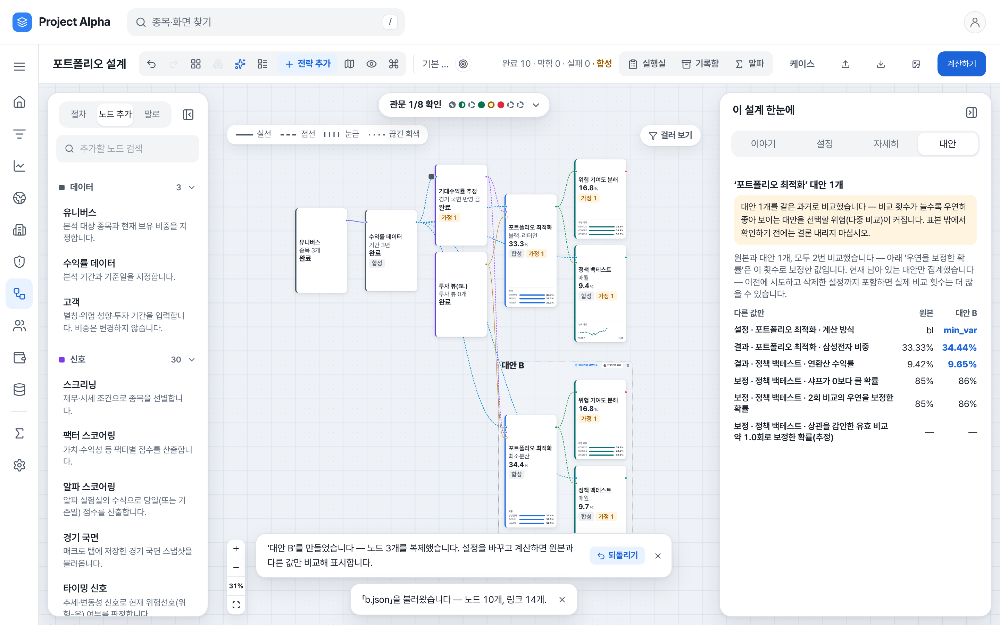

# 캔버스 — 단계 건너뛰기 · 대안 비교 확장 설계 (2026-11-13)

> 상태: ★설계 — 승인 전. 제품 코드는 0줄 바뀌었다.★ 승인하시면 구현 계획(TDD)을 따로 쓴다.
> 요청: "캔버스 다음 방향 — 노드 건너뛰기 · 대안 비교 표 · 승격 (설계부터)".
> 이 기능이 답하는 질문은 **② 전달 안정성**의 한 조각("이 단계가 있을 때와 없을 때 결과가 어떻게 달라지는가")이다.
> ★예측 스킬(③)·경제적 가치(④)의 증거가 아니다★ — 같은 과거에서 설정을 바꿔 본 차이는 우연히 좋아 보이는 쪽을 고를 위험을 키운다.

## 0. 먼저 — 셋 가운데 둘은 이미 있다

조사해 보니(읽기 전용) '대안 비교 표'와 '승격'은 이미 제품에 있다. 새로 만들 것은 **건너뛰기** 하나이고, 비교 표는 **넓히는** 일이다.

*지금 화면(로컬 · 합성 데이터). 최적화 노드에서 '대안 만들기' → 대안의 계산 방식을 바꾸고 계산 → 오른쪽 '대안' 탭.*

| 있는 것 | 어디 | 하는 일 |
|---|---|---|
| 대안 만들기(≤ 4) | `GraphNode.tsx:260` · `storeLayout.ts::makeBranch` | 고른 노드와 같은 전략 안의 하류를 복제해 점선 틀로 놓는다 |
| 대안 비교 표 | `Branches.tsx::BranchCompare` | 원본·대안을 열로, ★값이 다른 행만★ — 바꾼 설정 + 노드마다 헤드라인 한 값 |
| 우연 보정(PSR·DSR) | `Branches.tsx::DsrRows` → 서버 | 과거 성과 노드가 있으면 비교 횟수로 보정한 확률 세 줄 |
| 승격 | `storeLayout.ts::promoteBranch` | "이 대안을 원본으로" — 바뀐 설정을 원본에 옮기고 대안을 지운다(되돌리기 가능) |
| 정직성 문장 | `Branches.tsx` 표 위 | 다중 비교 경고 · 순위·추천·정렬 없음 |

**빈 곳 셋**(위 화면에서 보인다):
1. 어떤 단계를 "없이" 계산해 볼 길이 없다 — 노드를 지우고 선을 손으로 다시 이어야 한다.
2. 비교 표가 좁다 — 과거 성과 노드는 연환산 수익률 하나만 나온다. 낙폭·변동성·샤프·회전율은 노드 패널을 하나씩 열어야 하고, 두 곡선을 겹쳐 볼 수 없다.
3. 설정 행의 값이 서버 원문이다 — 화면의 `bl` → `min_var`(선택지 이름은 '블랙-리터먼' · '최소분산'). 용어집 §6(서버 열거값 원문을 화면에 싣지 않는다)에 어긋난다.

## 1. ① 단계 건너뛰기

### 1.1 무엇을 건너뛸 수 있나 — 넷뿐이다 (관측)

"건너뛴다"는 **그 노드가 받은 것을 그대로 다음으로 넘긴다**는 뜻이다. 그러려면 입력과 출력의 종류가 같아야 한다.
서버 노드 목록 88종을 훑으니(`allocation_graph_routes.REGISTRY`) 해당하는 것은 넷이다.

| 노드 | 통과시키는 것 | 건너뛰면 묻는 질문 | 조건 |
|---|---|---|---|
| 스크리닝 `screener` | 유니버스 → 유니버스 | 조건으로 거르지 않으면? | 앞에 유니버스가 이어져 있을 때만(없으면 이 노드가 종목의 원천이다) |
| 노출 중립화 `neutralize` | 비중 → 비중 | 중립화하지 않으면? | — |
| 노출 오버레이 `exposure_overlay` | 비중 → 비중 | 타이밍·국면으로 노출을 조절하지 않으면? | 신호·국면 입력은 쓰이지 않는다 |
| 기업 전망 `company_views` | 전망 → 전망 | 기업 전망을 더하지 않으면? | 앞에 전망이 이어져 있을 때만 |

넷뿐이라 **단독 기능으로는 작다.** 쓰임은 대안과 묶을 때 난다: 대안에서 그 단계를 건너뛰고 원본과 나란히 비교한다 — "오버레이가 무엇을 바꿨나".

### 1.2 접근 셋

**A. 화면이 선을 돌려 잇는다 (추천)**
- 문서 노드에 선택 칸 `bypass: true`(켰을 때만 실린다). 계산 요청을 만들 때(`useRunActions.ts:40` — `toDoc(nodes, edges)`) 건너뛴 노드를 빼고,
  그 노드의 통과 입력에 이어진 원천을 그 노드의 출력에 이어진 대상들에 바로 잇는다. 순수 함수 하나(`entities/portfolio-graph/bypass.ts`)로 둔다.
- 서버 0줄. 서버는 실제로 계산한 그래프만 보므로 **계보·증거 관문이 사실 그대로**다(건너뛴 노드는 계산되지 않았고 계보에도 없다).
- 기존 문서·요청 골든은 바이트 그대로다(건너뛴 것이 없으면 같은 문서 · 같은 요청).
- 약점: 화면이 계산 그래프의 모양을 바꾼다. "서버가 계산하고 화면은 그린다"는 원칙에 닿는다 — 그래서 변환을 한 함수에 가두고, 요청 본문을 직접 검사하는 시험으로 묶는다.
  실행 기록(서버 저장분)에는 건너뛴 뒤의 그래프가 남는다 — 기록 화면에 "건너뛴 단계 n개"를 화면 쪽 메모로 덧붙인다.

**B. 서버가 건너뜀을 안다**
- 요청 문서에 `bypass` 를 싣고 엔진(`src/engine/portfolio_graph.py`)이 통과 노드로 처리한다. 노드 상태에 `skipped` 가 생긴다.
- 장점: 실행 보고서·저장 기록에 "건너뜀"이 서버 사실로 남고, 통과 규칙이 레지스트리 한 곳에 있다.
- 단점: 엔진·검증·그래프 골든을 고친다. 상태 종류가 늘어 화면 전반(요약 줄 · 이야기 · 관문 · 필터)이 따라 바뀐다. 넷을 위해 치르기엔 크다.

**C. 만들지 않는다**
- 지금도 대안에서 노드를 지우고 선을 이으면 같은 계산을 할 수 있다(손이 더 간다). 넷뿐이라는 점을 무겁게 보면 이쪽이다.

추천은 **A** — 가장 작고, 증거 층을 건드리지 않고, 되돌리기 쉽다. B 는 건너뛸 수 있는 노드가 늘어나 기록의 정직성이 문제가 될 때 다시 본다.

### 1.3 화면 (A 기준)

- **켜고 끄기**: 노드 도구줄의 단추 "건너뛰기"(대상 넷에만 보인다) · 명령 찾기 "이 단계 건너뛰기/다시 적용". 조건이 안 맞으면 누를 수 없고 사유를 말한다("앞에 유니버스가 이어져 있어야 건너뛸 수 있습니다").
- **카드**: 흐리게 + 칩 "건너뜀" + 본문 한 줄 "이 단계 없이 계산합니다 — 받은 비중을 그대로 넘깁니다". 결과 자리는 비운다(계산하지 않았다 — 이전 결과를 남기지 않는다).
  이 노드로 들어오는 신호·국면 선은 점선으로(쓰이지 않는다).
- **낡음**: 켜고 끄면 하류가 낡는다(설정 변경과 같은 규칙).
- **대안과 함께**: 대안의 복제 노드에서 건너뛰면 대안 틀의 칩과 비교 표 설정 행에 "노출 오버레이 · 적용 → 건너뜀". 승격하면 건너뜀도 원본으로 옮긴다(설정과 같은 취급).
- **문장(늘 보인다)**: "이 단계의 유무에 따른 차이입니다 — 같은 과거에서 본 전달 차이이며, 이 단계가 앞으로도 도움이 된다는 증거가 아닙니다."

### 1.4 지킬 것

- 통과 규칙은 종류가 정한다 — 사용자가 임의의 노드를 건너뛸 수 없다(종류가 다른 것을 이으면 서버가 거절한다. 화면이 먼저 막는다).
- 건너뛴 노드의 결과를 지어내지 않는다 · 건너뛴 사실을 숨기지 않는다(카드 · 이야기 · 기록).
- 상자 크기·자리 · 포트 DOM · 기존 CSS 클래스 그대로(새 클래스만 더한다 — ADR 001).

## 2. ② 대안 비교 넓히기

| | 지금 | 제안 |
|---|---|---|
| 2.1 성과 행 | 과거 성과 노드마다 헤드라인 하나(연환산 수익률) | 서버 view 에 이미 있는 값으로 행을 더한다 — 누적 · 연환산 · 최대 낙폭 · 변동성 · 샤프 · 평균 회전율 · 비용 가정. ★새 수치 0★(화면이 계산하지 않는다) · "다른 값만" 규칙 유지 |
| 2.2 곡선 | 없음 | 원본 ↔ 고른 대안 **하나**를 겹쳐 본다 — 기존 `shared/ui/perf/PerfCompare`(두 곡선 + 차이 띠 · 읽는 줄 · 표 쌍둥이). 다섯 선을 한 그림에 겹치지 않는다(읽을 수 없고 '가장 높은 선' 고르기를 부추긴다) |
| 2.3 설정 값 | 서버 원문(`bl` → `min_var`) | 선택지 이름('블랙-리터먼' → '최소분산') — 스키마의 선택지 라벨을 쓴다 |

그대로 두는 것: 다중 비교 문장 · PSR·DSR 세 줄 · 순위·정렬·추천 없음 · 색으로 승패를 칠하지 않음(다른 값은 지금처럼 굵게만).
계산하지 못한 칸은 "—"(0 이 아니다). 낡은 결과는 쓰지 않는다.

## 3. ③ 승격 — 그대로 둔다

승격은 이미 되돌릴 수 있고, 무엇이 옮겨지는지는 대안 틀의 칩과 비교 표 설정 행에 먼저 보인다. 별도의 미리 보기 창은 같은 정보를 한 번 더 보여 줄 뿐이라 **만들지 않는다.**
바뀌는 것은 하나 — ①을 만들면 승격이 건너뜀 표시도 함께 옮긴다.

## 4. 시험·검증 계획 (승인 뒤 TDD)

- 순수 함수 `bypass`: 넷 각각의 재배선 · 조건이 안 맞는 경우의 사유 · 연달아 건너뛴 두 노드 · 하류가 여럿인 경우 · ★짝★ 건너뛴 것이 없으면 입력 그대로(같은 객체 모양).
- E2E(새 스펙): 건너뛴 뒤의 **요청 본문**에 그 노드가 없고 선이 이어져 있다 · 서버가 그 요청을 받아 계산한다 · 카드에 "건너뜀" · 하류 낡음 ·
  대안에서 건너뛰면 비교 표에 행이 생긴다 · 승격이 건너뜀을 옮긴다 · AA 라이트/다크.
- 비교 확장: 행의 값 = 서버 view 의 값 그대로(응답을 가로채 바꾸면 화면이 바뀐다 — 짝) · 곡선은 고른 둘만 · 설정 값이 라벨로 나온다.
- 불변: `canvas-doc.json` · 요청 골든 · 캔버스 화면 골든은 건너뛴 것이 없는 문서에서 바이트 그대로. 변이 넷 이상.
- 성능: 재배선은 계산 요청 때 한 번 — 끌기·확대 경로에 넣지 않는다.

## 5. 결정해 주실 것

1. **건너뛰기** — A(화면 재배선 · 추천) / B(서버가 안다) / C(만들지 않는다).
2. **비교 넓히기** — 2.1 · 2.2 · 2.3 전부(추천) / 일부만.
3. **순서** — 2.3(값 표기 · 작다) → 2.1 → 2.2 → ① 을 권한다: 앞의 셋은 지금 화면을 바로 낫게 하고, ①은 그 표 위에 얹힌다.

## 6. 하지 않는 것 · 모르는 것

- 자동 파라미터 훑기 · 가장 좋은 대안 추천 · 대안끼리 통계 검정(DSR 밖) · 임의 노드 건너뛰기 · 서버 수정(A 를 고르면).
- 모르는 것: 건너뛰기를 실제로 얼마나 쓰게 될지(사용 기록 없음) · 대안 5개 곡선을 한 번에 보고 싶다는 요구가 있는지 · 실제 기기·다른 브라우저(미검증).
