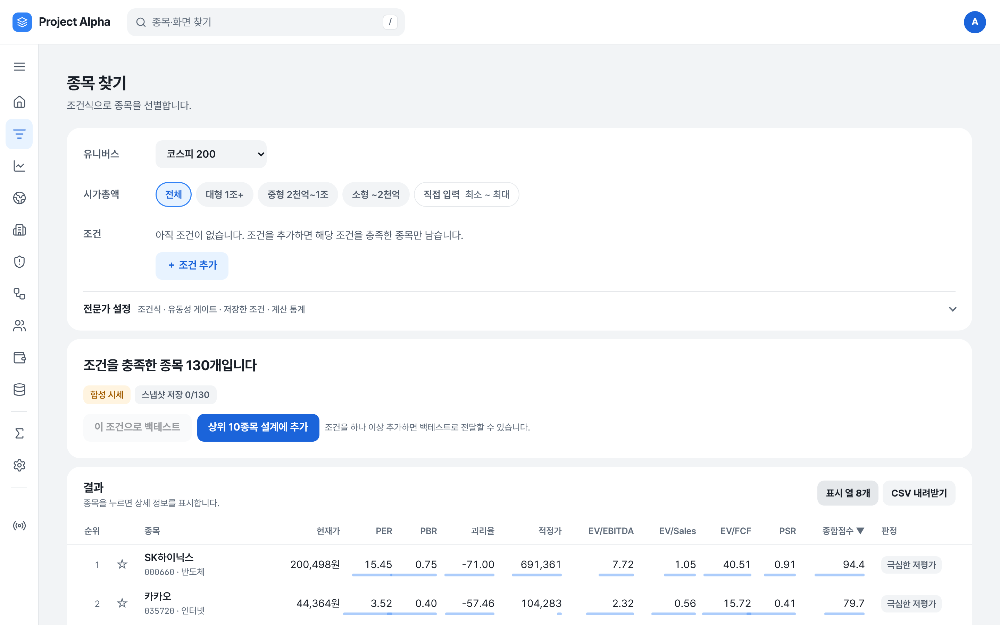
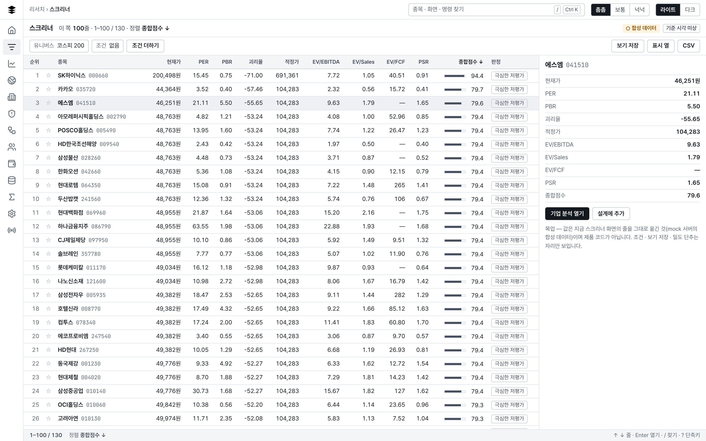

# UI/UX 전문화 — 감사와 로드맵 (2026-11-20 · 문서만 · ★승인 대기★)

> **상태: 승인 대기.** 이 문서는 감사(관측)와 계획이다. 화면 · 계산 · 서버 코드는 한 줄도 고치지 않았다. 승인 뒤 화면 단위로 구현한다(§8).
> 관련 기록: ADR 001(Tailwind · shadcn) · 002(노드 캔버스) · ★003(토스식 시각 언어 — 이 문서 §6 이 대체 · 개선을 제안)★ · 004(차트 경계) · 005(문체) · 006(트레이더 도구) ·
> 설계 `2026-11-19-workspace-panels-design.md`(판 배치) · 용어집 `docs/specs/2026-11-11-ui-terminology.md` · 제품 규칙 `docs/specs/2026-09-12-ra-product-rules.md`.
> 잰 값의 조건: 커밋 `028ae09` 의 트리 · 2026-11-20 · 이 환경(합성 데이터 · mock 서버 · Chromium 하나 · 4코어). 코드에서 센 값은 스크립트(`ds_scan.py` · `cap_matrix.py`), 화면에서 잰 값은 Playwright 스크립트(`measure.mjs` · `interact.mjs`)가 냈다 — 모두 세션 스크래치(저장소 밖)이며 방법은 각 절에 적는다. 그 뒤의 커밋 둘(`52cd976` · `89a940b`)은 시험만 고쳤다 — 화면 소스는 같다.

**받은 산출물 열 항목 ↔ 이 문서의 절**
| 받은 항목 | 절 |
|---|---|
| 1 현재 디자인 시스템 진단 | §1 |
| 2 화면별 UX 문제와 코드 위치 | §2 |
| 3 전문 금융 플랫폼 참고 패턴 | §3 |
| 4 추가 · 개선할 부품 목록 | §4(패턴별 판정) · §5.1 |
| 5 기존 부품 재사용 계획 | §5.0 · §5.2 · §5.3 |
| 6 적용 우선순위(P0 · P1 · P2) | §4 의 판정 칸 · §4.L(한눈에) |
| 7 시각 디자인 개선안 | §6(ADR 007 초안) |
| 8 접근성 · 성능 검증 계획 | §7 |
| 9 단계별 구현 · 시험 계획 | §8 |
| 10 수정하면 안 되는 기존 설계 결정 | §9 |
| (더한 것) 받은 결정 · 패널 결론 · 도구 감사 · 승인받을 결정 · 한계 | §0 · §10 · §11 |

**먼저 볼 곳**: 결정 일곱(§10) → 스크리너의 지금과 제안 그림(§2.5) → ADR 007 초안(§6) → 조각 표(§8.1).

## 0. 받은 말 · 받은 결정 · 패널 결론

### 0.1 받은 말(요약 — 원문은 싣지 않는다)
사용자가 다른 AI 와 나눈 대화 둘을 긴 프롬프트로 주었다. 갈래는 셋이다.
1. **UI/UX 전문화** — 화면 효과 · 모션 중심의 용어 목록이 금융 전문 도구에는 맞지 않는다는 진단에서 출발해, 열 영역(화면 구조 · 부품과 탐색 · 데이터 표 · 차트 · 노드 캔버스 · 작업 흐름 · 상호작용 · 시각 스타일 · 디자인 시스템 · 접근성과 성능)과
   금융 전용 패턴(주문 표 · 주문 화면 · 신선도 · 출처 · 재생 등)을 정리하고, 'Project Alpha UI/UX 전문화 작업' 프롬프트(감사 → 디자인 방향 → 패턴 검토 → 화면별 개선안 → 개발 원칙 → 산출물 10항목)를 제시한다.
   방향은 "Bloomberg 수준의 정보 밀도 + TradingView 의 차트 상호작용 + Linear 의 일관성 + 노드 캔버스". ★"이번 단계에서는 분석과 설계 문서 … 설계 승인 이후 화면 단위로 구현"★.
2. **초개인화 포트폴리오 AI 에이전트** — Rogo · AlphaSense · CereFin · Anthropic 을 참고한 여러 걸음 실행 · 공시 근거 검색 · 고객 조건 반영. → ★다음 문서★(§8.4).
3. **금융 데이터 확보 길** — 공공 · 무료 → 저가 상용 → 기관용. → ★다음 문서★(§8.4).
그리고 "스킬 · 플러그인을 적극 활용".

### 0.2 받은 결정(2026-11-20 · 질문 넷)
| 물음 | 답 |
|---|---|
| 먼저 할 것 | **UI/UX 감사 · 로드맵 문서 먼저** → 승인 요청에서 멈춤. 에이전트 · 데이터 설계는 그다음 문서 |
| 예측 연계(P — 하루 유형 → 남은 하루 · 시장 국면 → 다음 날 · 공용 특징 표) | **에이전트 설계 문서의 한 절로** — 예측 모형은 에이전트가 부르는 도구의 하나 |
| 화면 방향 | **"1번 + 2번으로 해. ADR 003 를 개선할 필요가 있어"** — 앱 전체를 정보 밀도 방향으로 옮기고(ADR 003 을 새 ADR 로 대체 · 개선) 그 안에서 화면 성격별로 단을 나눈다 |
| 하위 에이전트 | **쓰지 않음** — 직접 하고 관점은 패널 표로 |
| (11-20 앞선 질문) G6 2b 창 띄우기의 띄울 판 | **읽기 전용 판만** — 이 로드맵의 한 항목(§8.1) |

### 0.3 패널 결론 — 감사의 쟁점 (재무 · DB · 퀀트 · 수학 · 금융 · 웹디자인)
| 쟁점 | 갈린 의견 | 결론(근거) |
|---|---|---|
| 감사의 잣대 | 웹디자인: 안목에 따른 비평 / 퀀트 · 수학: 잰 값만 | ★잰 값 + 코드 위치★. 비평은 잰 값에 붙인다 — 이 저장소의 규칙(결론은 증거보다 강할 수 없다)을 화면에도 건다 |
| '정보 밀도'의 뜻 | 트레이더: 한 화면에 더 많은 줄 / 웹디자인: 글자를 줄이면 읽기 어렵다 / 금융: 숫자를 잘못 읽는 것이 가장 비싸다 | 밀도 = ★스크롤 없이 견줄 수 있는 줄 · 칸의 수★이며 글자 크기만 줄이는 것이 아니다 — 줄 높이 · 여백 · 테두리 · 표 머리 고정 · 숫자 정렬을 함께. 본문 글자의 바닥은 12px(작업 단) |
| 밀도 방향의 범위 | 트레이더: 전부 촘촘하게 / 금융(PB): 고객에게 보이는 화면은 명료 · 신뢰 | 앱 전체의 바탕 언어를 옮기고(ADR 007) 단 셋으로 조인다 — 작업 · 해석 · 설명(§6.2). 사용자 밀도 전환을 둔다 |
| 다크 기본값 | 트레이더: 다크 / 웹디자인: 지금은 사용자 설정 → 시스템 설정 · 골든과 README 그림이 라이트 | 기본값은 바꾸지 않는다(시스템 설정을 따름). 대신 ★작업 단의 모든 화면은 다크에서 라이트와 같은 검사를 지난다★를 규칙으로(지금도 준비 목록에 있다 — §1.1) |
| 표 부품 | 웹디자인: 헤드리스 라이브러리(TanStack) / 공급망 · 계약: 새 의존성 0 · 클래스 = E2E 계약 | 먼저 ★공용 표 부품을 직접★(정렬 · 머리 고정 · 밀도 · 숫자 정렬 · 키보드) — 가상화는 잰 값이 요구할 때만(§2.4 — 지금은 들이지 않는다) |
| 차트 상호작용 | 트레이더: 십자선 동기 · 확대 / ADR 004: 라이브러리를 갈아타지 않는다 · canvas 금지 · 툴팁 금지 | 기존 '읽는 줄'(`ChartReadout`)을 화면 안에서 ★함께 움직이게★ 잇는다(같은 날짜 · 같은 봉) — 새 라이브러리 0 |
| 패턴을 얼마나 들이나 | 웹디자인: 목록의 60여 개 / 재무 · DB: 쓰임이 드러난 것만 | 패턴마다 있음 · 부분 · 없음 → P0 · P1 · P2 · ★하지 않음★(§4). 유리 효과 · 패럴랙스 · 자석 단추 · 스크롤 등장은 작업 · 해석 단에서 '하지 않음' |
| 색의 뜻 | 금융: 한국 관례(상승 빨강 · 하락 파랑)를 끝까지 / 웹디자인: 위험도 빨강 · 강조도 파랑이라 겹친다 / 잰 값: 등락색 규칙은 하나로 서 있고 겹치는 것은 ★값★이다(하락 글자 = 주 단추 · 켜진 메뉴 · 상승 글자 = 위험 — §1.4) | ★등락색은 한 가지(한국 관례 — ADR 003 §3 유지) · 수와 그 표식에만★ · 상태색은 수에 입히지 않고 늘 아이콘 · 낱말과 함께 · 강조색은 등락색과 값이 겹치지 않게(§6.4 · 결정 D2) — 숫자를 거꾸로 읽게 하는 것이 가장 비싼 결함이라 P0 |
| 감사 중 고칠 것이 보이면 | 웹디자인: 바로 고침 / 프로세스: 승인 전 코드 0줄 | 고치지 않고 적는다 |
| 우선순위 | — | CLAUDE.md 불변식 > 데이터 무결성(출처 · 시점) > 통계 타당성 > 트레이더의 쓰임 > 표현 |

### 0.4 도구 감사 기록 (받은 말의 '스킬 · 플러그인 · MCP 적극 활용')
쓴 것만 '썼다'고 적는다. 설치 · 설정은 하나도 하지 않았다(플러그인 설치 · hooks 는 사용자 결정).
| 도구 | 상태 | 이 감사에서 한 일 |
|---|---|---|
| 스킬 `impeccable`(제품 UI 규칙) | 있음 — 본문만(하위 명령의 참고 파일 · 스크립트는 이 환경에 동기화돼 있지 않다) | 금지 목록(옆줄 강조 테두리 · 그라데이션 글자 · 기본값으로 쓰는 유리 효과 · 똑같은 카드 격자 · 임의의 `z-index`)과 대비 · 모션 규칙을 §4 · §6 의 판정 기준으로 썼다. 제안 그림의 고른 줄에서 옆줄 강조를 걷은 것도 이 규칙 |
| 스킬 `ui-ux-pro-max`(UX 점검표) | 있음 — 본문만(찾기 스크립트 없음) | 점검표 열 묶음을 잰 값과 대조했다(§7.5). 색 · 글꼴 · 양식 추천 기능은 쓰지 않았다 — 새 제품용이고, 이 제품은 색의 뜻(등락 · 상태)이 먼저다 |
| 스킬 `dataviz`(차트 규칙 · 색 검증) | 있음 | 축 하나 · 색은 뜻으로 · 상태색은 예약 · 글자는 계열 색을 입지 않는다 — §4.D 와 §6.4 의 기준. 색 검증 스크립트는 차트 색을 바꾸는 조각(U11)에서 돌린다(이번에는 색을 바꾸지 않았다) |
| 스킬 `design-taste-frontend` | 있음 · ★쓰지 않음★ | 스킬 스스로 "랜딩 · 포트폴리오용 — 대시보드 · 데이터 표 · 여러 단계 제품 UI 아님"이라고 밝힌다 |
| 스킬 `brainstorming` · `writing-plans` · `verification-before-completion` · `systematic-debugging` · `test-driven-development` | 있음 | 감사 → 설계 → 승인의 흐름 · 문서를 내기 전 검증 · 함께 고친 CI 두 건(시험만) |
| 사전 설치된 Playwright + Chromium | 있음 | 화면 재기 전부(§2.0) — 프로젝트가 고정한 Playwright 판과 설치된 브라우저 빌드가 달라 실행 파일을 지정해 띄웠다 |
| GitHub MCP | 있음 | CI 판정 조회 · PR 본문 |
| Figma MCP | 있음 · 쓰지 않음 | 디자인 파일이 없다 — 주시면 토큰 · 부품을 대조한다 |
| 공식 플러그인 `frontend-design` · `claude-code-setup` · `typescript-lsp` | 카탈로그에 있음 · ★설치 안 됨★ | 설치 카드를 띄웠다. 설치되면 구현 조각에서 쓴다(시각 개선 · 자동화 추천 · 참조 찾기) — 없어도 진행에 지장 없다 |
| `feature-dev` · `playwright` MCP · 커뮤니티 접근성 플러그인 | 카탈로그 | 권하지 않는다 — 하위 에이전트 방식(받은 결정과 다름) · 사전 설치와 겹침 · 검증 등급을 확인하지 못함 |
| 스킬 `skill-creator` · `update-config`(hooks) · `claude-api` · `mcp-builder` | 있음 · 이번에는 쓰지 않음 | 승인 뒤: 프로젝트 전용 UI 스킬(U0) · 검사 hooks(제안 — 사용자 결정) · 에이전트 설계 문서를 쓰기 전에 먼저 읽는다 |
| 하위 에이전트 | 쓰지 않음(받은 결정) | 관점 여섯(재무 · DB · 퀀트 · 수학 · 금융 · 웹디자인)은 패널 결론 표로 |

## 1. 현재 디자인 시스템 진단 (관측 — 코드에서 센 값)

### 1.1 한눈에
| 잰 것 | 값 | 읽기 |
|---|---|---|
| 스타일의 자리 | `frontend/src/app/globals.css` 한 파일 11,232줄 · 규칙 블록 약 7,100 | Tailwind 유틸리티 클래스 쓰임은 약 60곳뿐 — 실제 시스템은 손으로 쓴 CSS 다(`tailwind.config.js` 는 글꼴과 터미널 색 여섯을 hex 로 따로 가진다) |
| 사용자 정의 속성(토큰) | 정의 383 · `var()` 로 한 번도 쓰이지 않는 것 104(이름을 실행 중에 짓는 가족 다섯은 뺌) | 쓰지 않는 토큰이 넷에 하나 |
| 토큰 가족(접두어) | 20가지 넘음 — `pg` 67 · `bs` 36 · `tx` 27 · `mc` 22 · `ld` 16 · `rg` 12 · `pf` 12 · `t` 10 … | 층이 일곱(§1.2) — 한 벌의 의미 토큰이 없다 |
| 글자 크기 | ★40가지★ — 13px 509회 · 14px 318 · 12px 311 · 15px 142 · 11px 141 · 12.5px 98 · 13.5px 66 · 10px 54 … 반 px 값 일곱 | 토큰(`--fs-*` 여덟 단: 11 · 12 · 13 · 14 · 16 · 18 · 22 · 28)이 있지만 쓰는 선언은 31. px 로 적은 선언 1,948 가운데 척도 안의 값은 1,362(70%) — 화면에 보이는 글자로 세면 73%(§2.2 C9) |
| 굵기 · 줄 높이 | 굵기 여섯(600 430회 · 700 420 · 500 55 · 800 35 · 400 34 · 750 2) · 줄 높이 20가지 | 600 과 700 이 거의 같은 횟수 — 위계가 굵기로 갈리지 않는다 |
| 반경 | 25가지 넘음 — 12px(`--tx-r-row`) 126 · 2px 120 · 10px 109 · 8px 102 · 3px 65 · 6px 57 · 4px 49 · 999px 43 · 20px(`--tx-r-sec`) 33 … | 터미널식(2 · 3px)과 토스식(12 · 20px)이 함께 산다 |
| 간격 | `gap` 8px 239 · 6px 223 · 10px 118 · 12px 115 · 4px 108 · 2px 89 · 14px 38 … / `padding` 값 12 · 10 · 8 · 14 · 16 · 6 · 4 · 3 · 18 · 2 · 20 · 7 … | 토큰(`--sp-*`: 4 · 8 · 12 · 16 · 20 · 24 · 32)을 쓰는 곳은 48 — 6 · 10 · 14 · 18 처럼 척도 밖의 값이 흔하다 |
| 깊이 | `z-index` 22가지(−1 ~ 9998) · 척도 토큰 없음 / `box-shadow` 선언 240 — 안쪽 선(`inset`) 93 · 퍼짐 없는 고리(`0 0 0 …`) 41 · 초점 규칙 안 9 · `none` 21(갈래는 겹칠 수 있다) · 가족별로는 캔버스 `pg` 54 · 첫 화면 `ld` 15 · `tx` 13 … | 그림자 선언의 큰 몫은 테두리 · 고리 구실이다 — '장식 그림자 없음'(ADR 001 · 003)과 어긋나는지는 띄우는 그림자만 골라 조각에서 본다 |
| 날 색 | 토큰 정의 밖의 hex 456곳(118가지) · `rgb()` 104곳 · TSX 인라인 `style` 242곳 | 다크 짝은 생성 구역이 메운다(ADR — 다크 구역 생성기) |
| 클래스 가족 | 45가지 넘음 — `pg` 2,388 · `mc` 579 · `ca` 457 · `ci` 388 · `tx` 337 · `itd` 334 · `ld` 309 · `ma` 267 … | 공용(`tx-*`)은 337 — 화면마다 제 클래스가 대부분 |
| 표 | `<table>` 쓰는 파일 58 · 표 클래스 26가족(`pg-table` 80 · `tj-table` 17 · 한 번만 쓰는 것 스물 남짓) | 공용 표 부품이 없다. ★정렬이 되는 표는 스크리너 하나★ · 표 머리가 붙는 표는 넷(`.bsc-table` · `.pf-table-scroll` · `.cr-scroll` · `.tj-table`) · 첫 열이 붙는 표는 하나(`.rk-map`) · 줄무늬 0 |
| 단추 | 첫 클래스 176가지 — `tx-btn` 128 · `pg-btn` 34 · `set-btn` 15 … | 공용 단추가 있지만 변형이 화면마다 새 이름 |
| 반응형 | 중단점 ★25가지★(640px 28회 · 760 · 820 각 8 · 560 · 720 각 7 · 900 · 1000 각 5 …) · 컨테이너 질의 9 | 표준 중단점 묶음이 없다 |
| 모션 | `@keyframes` 59(첫 화면 · 로그인의 `ld-*` · `lp-*` · `lg-*` 가 33) · 줄인 모션 블록 29 + '움직임을 허용할 때만' 블록 10 | 화면에서 잰 값: 제품 화면에서 도는 애니메이션 0 · 첫 화면 46 · 줄인 모션에서는 모두 0(§2.2) |
| 접근성 표지 | `aria-label` 519 · role 30가지 · `:focus-visible` 규칙 201 · `outline: none` 30(13은 `:focus-visible` 짝 · 17은 같은 규칙 안의 테두리 · 그림자 고리) · 요소의 `title=` 63(57이 캔버스) | `outline: none` 은 모두 다른 표시가 있다. 실제 초점 결함은 따로 있다(§2.2 C4 · C5 · C7) |
| 쓰이는 CSS | 화면 23 × 두 테마를 굴려 가며 잰 사용 범위 32.4%(683,852자 가운데 221,758) | ★상한★ — 열지 않은 시트 · hover · 오류 상태는 안 쓴 것으로 셌다(§2.2 C15) |
| 테마 | 라이트 · 다크 — 저장값 → 시스템 설정 · 다크는 준비된 경로 목록(`shared/theme/theme.ts::DARK_READY` — 개발 화면만 예외) | 모든 제품 화면이 다크 준비 목록에 있다 |
| 가장 큰 화면 파일 | `PortfolioCanvas.tsx` 920줄 · `TerminalScreener.tsx` 790 · `widgets/backtester/BacktestResults.tsx` 741 · `SettingsPanel.tsx` 737 | — |

### 1.2 토큰의 층 — 시대가 일곱 겹으로 쌓여 있다
`globals.css` 에서 읽은 순서(파일 위 → 아래): ① `--bs-*`(랜딩 CSS 에서 옮겨 온 것 — 이제 `--tx-cta` 를 가리킨다) → ② 옛 이름 별칭(`--accent` · `--bg-page` …) → ③ 'Phase 5'(`--color-bull` · `--color-bear` · `--cockpit-*`)
→ ④ 터미널 셸(`--t-*` — 흰 바탕 · #e5e5e5 테두리) → ⑤ shadcn 다리(`--background` … — `--t-*` 를 가리킨다) → ⑥ 차트(`--chart-*`) → ⑦ 토스식(`--tx-*` — 파일 끝 · ADR 003) + 캔버스(`--pg-*`) + 모듈별.
ADR 003 §2.2 가 "`:root` 블록은 나누거나 순서를 바꾸지 않는다 · 새 토큰은 파일 끝"으로 못 박아 층이 쌓이기만 했다(그 규칙의 까닭은 라이트 골든 — 유지한다 · §9).
★판정★: 값이 흩어진 것이 아니라 ★이름이 흩어져 있다★ — 같은 회색 계단 · 같은 파랑이 층마다 다른 이름으로 산다. 의미 토큰 한 벌(§6.3)을 파일 끝에 두고 옛 이름을 그 별칭으로 돌리면 값은 한 곳에서 바뀐다(골든 변화 0 으로 시작할 수 있다).

### 1.3 척도 — 종이에는 있고 쓰이지 않는다
글자(`--fs-*` 여덟 단) · 간격(`--sp-*` 일곱 단)은 이미 정의돼 있다. 쓰는 곳이 31 · 48 뿐이라 화면은 40가지 크기 · 척도 밖 간격으로 그려진다. 반경 · 깊이는 척도가 없다.
★판정★: 새 척도를 발명할 일이 아니라 ★있는 척도를 줄여 쓰게 하는 일★이다 — 화면 단위 조각마다 그 화면의 날 값을 토큰으로 옮기고(계산 스타일 골든으로 변화 0 또는 의도한 변화만), 새 날 값은 가드 시험으로 막는다(§7.3).

### 1.4 색 — 등락색 규칙은 하나로 서 있고, ★한 값이 두 뜻★이다 (P0)
토큰마다 '어떤 CSS 규칙이 쓰는가'를 세고(`sem_colors.py`), 화면에서 그 색을 입은 글자를 셌다(`measure.mjs` — 제품 화면 19 · 1440 라이트).
| 값(라이트) | 같은 값을 가진 토큰 | 뜻 | 화면에서 잰 쓰임 |
|---|---|---|---|
| `#3182f6` | `--tx-down` = `--tx-blue` | ★하락(그림 · 큰 수)★ = ★강조(초점 고리 · 켜진 표시 — `var()` 170곳)★ | (그림 · 테두리라 글자 수로 세지 않았다) |
| `#1b64da` | `--tx-down-ink` = `--tx-cta`(= `--t-accent`) | ★하락 글자★ = ★주 단추 · 링크 · 켜진 메뉴★(`var()` 114곳) | 글 107 · 수 102 · 누르는 것 45 · 바탕 41 — 수 102 가운데 92 가 위험 화면의 하락 값(뜻에 맞는 쓰임)인데 같은 화면의 켜진 메뉴 이름과 누르는 줄도 같은 파랑이다. 분봉의 '필수' 표지 17 · 기업의 정보 칩과 목차도 같은 값 |
| `#d22a3b` | `--tx-up-ink` = `--tx-danger` | ★상승 글자★ = ★위험 · 오류★(규칙 44) | 글 19 · 수 16 · 누르는 것 8 — 분봉의 입력 오류 문장 7 이 상승 수와 같은 빨강 |
| `#f04452` | `--tx-up` | 상승(그림 · 큰 수) | 매수 구역의 켜진 스위치 바탕 1 |
다크도 같은 겹침이다(`--tx-down` = `--tx-down-ink` = `--tx-blue` = `#4d94ff` · `--tx-up` = `--tx-up-ink` = `--tx-danger` = `#ff6b76` — 주 단추 `--tx-cta` 만 `#8ab8ff` 로 갈린다). 토큰의 자리: `frontend/src/app/globals.css:6436` ~ `:6453`.

같은 재기에서 본 나머지:
| 뜻 | 토큰(쓰는 CSS 규칙 수) | 읽기 |
|---|---|---|
| 등락 · 손익 — 한국 관례(빨강 = 상승 / 파랑 = 하락) | `--tx-up` 14 · `--tx-down` 15 · 글자용 `-ink` 14 · 15 + 성과 문법의 별칭 `--pf-up` · `--pf-down` 17 | ★한 규칙★ — ADR 003 §3 이 지켜지고 있다 |
| 매수 · 매도 구역의 강조 | 백테스트 편집기는 구역의 강조색을 매수 = 빨강 · 매도 = 파랑으로 바꾼다(`frontend/src/app/globals.css:6841` · `:6842`) | 관례 안의 쓰임(매수/매도 조작부는 등락색의 예외) — 다만 켜진 스위치와 고른 단추 글자가 '위험'과 같은 빨강이 된다 |
| 상태(통과 · 실데이터 · 완료 / 오류 / 주의) | `--tx-danger` 44 · `--tx-warn` 24 · `--tx-ok` 14 · `--pg-ok` 15 + ★옛 이름 `--color-bear` 13 · `--color-bull` 5★ | 옛 이름은 '약세 · 강세'인데 쓰임은 상태색이다 — `.brun-tl.done`(완료) · `.t-honesty-st.s-real`(실데이터) · `.tstate-error` · `.mc-warn` … → 이름이 뜻과 다르다 |
| 방향의 뜻으로 쓴 옛 규칙 하나 | `.ca-scen-card.bull`(초록 위 테두리 `frontend/src/app/globals.css:869`) · `.bear`(빨강 `:871`) | ★화면에 그려지지 않는다★ — 기업 화면에서 잰 위 테두리 색은 강세 · 기준 · 약세 카드 셋 다 `#191f28` 이다(뒤의 규칙이 덮는다). 화면 결함이 아니라 죽은 규칙 |
| 발산 척도(z 수준 · 민감도 칸) | `--mc-lv-pos-*`(주황) · `--mc-lv-neg-*`(청록) | 방향이 아니라 수준의 척도 — 유지(등락색과 섞지 않는다) |
| 쓰이지 않는 것 | `--bt-neg` · `--chart-down` · `--z-up` · `--z-down` · `--success` · `--danger` · `--color-caution-bg` · 함수 `toneColor` · `pctColor`(`frontend/src/entities/company/insightsModel.ts:79` · `:81` — 부르는 곳 0) | 걷을 후보(U0) |
★판정★: 숫자를 거꾸로 읽게 하는 것이 이 제품에서 가장 비싼 결함이라 P0 로 둔다. 규칙은 이미 하나이므로 고칠 것은 ★값의 겹침★(§6.4 · 결정 D2)과 ★이름이 뜻과 다른 토큰 · 죽은 규칙★(U0)이다.
★정정★: 계획을 쓸 때 "초록 = 상승 규칙이 함께 남아 있다"고 적었고 이 문서의 첫 초안에도 "한 화면에서 빨강이 상승과 약세를 함께 뜻한다"고 적었다 — 둘 다 틀렸다. 화면에서 재 보니 그 규칙은 그려지지 않는다.

### 1.5 부품 — 있는 것과 겹치는 것
- **공용으로 있는 것**(`frontend/src/shared/ui`): `tx/`(단추 · 탭 키 `rove` · 시트 `Sheet` · 답 문장 등) · `workspace/`(판 배치 · `MenuButton` · `RowSplitter`) · `split/`(구분선) · `perf/`(성과 문법) · `chart/`(읽는 줄 `ChartReadout` · 봉 차트 · 표식 규격) · `plot/` ·
  `States.tsx`(빈 · 오류 · 로딩) · `evidence.tsx` · `EvidenceDrawer`(근거 서랍) · `PerfLabel`(성과 라벨) · `MiniViz`(스파크라인 · 열지도) · `AllocationMap` · `Donut` · `shadcn/`(Radix 위의 표 · 팝오버 · 토글 묶음 등) · 부품 카탈로그 `/dev/ui`(`CatalogueShell`).
- **겹치는 것**: 표 26가족 · 단추 176가지 · 고르기 단추(세그먼트) 셋 이상(`tx-mode-b` · `ma-seg-b` · Radix 토글 묶음) · 빈/오류/로딩 상태(공용 `States` 를 쓰는 묶음은 스크리너 · 캔버스 · 매크로 · 관리 — 백테스터 · 분봉 · 기업 · 내 계좌는 저마다).
- **만들어 두고 쓰지 않는 것**: `shared/ui/feedback.tsx` 의 `TickValue`(값이 바뀌면 0.6초 번쩍임) · 뼈대 로딩(skeleton) — 쓰는 곳이 `/dev/ui` 뿐이다(계획을 쓸 때 '번쩍임이 있다'고 적은 것은 이 부품이 제품 화면에 쓰이는 줄 안 내 잘못 — 제품 화면에는 없다).
- **화면 묶음별 능력**(코드에서 센 값 · `cap_matrix.py`):
  | 묶음 | 표 | 정렬 | 쪽 나눔 · 자르기 | 찾기 칸 | CSV | 공용 상태 부품 | `.num` |
  |---|---|---|---|---|---|---|---|
  | 스크리너 | 1 | ★있음★ | 있음(100줄) | 1 | 있음 | 2 | 31 |
  | 백테스터 | 7 | 0 | 14 | 1 | 0 | 0 | 68 |
  | 분봉 | 16 | 0 | 26 | 0 | 0 | 0 | 210 |
  | 캔버스 | 71 | 0 | 49 | 5 | 0 | 4 | 507 |
  | 매크로 | 7 | 0 | 10 | 1 | 0 | 11 | 28 |
  | 기업 | 11 | 0 | 5 | 0 | 0 | 0 | 6 |
  | 내 계좌 · 매매일지 | 5 | 0 | 8 | 0 | 0(매매일지는 CSV 를 읽기만) | 0 | 89 |
  | 관리 · 데이터 · 실거래 | 4 | 0 | 1 | 0 | 0 | 6 | 47 |

### 1.6 진단의 요약
1. 시스템은 있다 — 토큰 · 척도 · 공용 부품 · 카탈로그 · 접근성 표지 · 다크 · 계약 시험이 이미 있다. 없는 것은 ★한 벌로 조이는 규칙★이다.
2. 화면이 두 언어로 그려져 있다 — 터미널식(2 · 3px · 흰 바탕 · 테두리)과 토스식(12 · 20px · 회색 바탕 위 흰 절). ADR 003 의 '모듈 단위 전환'이 끝나지 않은 채 방향이 바뀌었다.
3. 데이터 표가 가장 약한 고리다 — 표가 58 파일에 있는데 정렬 · 머리 고정 · 밀도 · 키보드가 공용이 아니다.
4. 가장 비싼 결함 후보는 색의 뜻(§1.4)이다 — 규칙은 하나로 서 있으나 ★한 값이 두 뜻★이다(하락 = 강조 · 상승 = 위험).

## 2. 화면별 UX 문제와 코드 위치 (관측 — 화면에서 잰 값)

### 2.0 재는 법
- **대상**: 라우트 23 — 제품 화면 19(아래 표) + `/builder`(백테스트 편집과 같은 화면 · 잰 값도 같다) + 첫 화면 `/` + 로그인 + 부품 카탈로그 `/dev/ui`.
- **변형 여섯**: 1440 × 900 라이트 · 다크 · 1920 × 1080 · 1280 × 800 · 390 × 844 · 1440 줄인 모션. 아래 값은 따로 적지 않으면 ★1440 × 900 라이트★.
- **무엇으로**: 세션 스크래치의 Playwright 스크립트 — `measure.mjs`(화면이 조용해진 뒤 DOM · 표 · 글자 · 색 · 조작 요소 · 대비 · Tab 36걸음을 한 번에) · `interact.mjs`(조작 22가지의 Event Timing) ·
  `numprobe.mjs`(숫자 글꼴 폭) · `focusprobe*.mjs`(초점 고리) · `csscov.mjs`(CSS 사용 범위) · `mock.mjs`(전/후 그림). 최종 빌드(`028ae09` 의 트리) + mock 서버(`KIS_USE_MOCK=1`) + 로그인 고정물. 스크립트는 저장소에 넣지 않았다(U0 에서 다듬어 넣는다 — §7.2).
- **낱말의 뜻**: '쪽' = 본문 구르는 높이 ÷ 본문 보이는 높이 · '보이는 글자' = 상자가 창에 걸친 요소의 글자 수 · '첫 블록 y' = 본문의 첫 절 · 표 · 그림이 시작하는 높이 ·
  '24px 미만' = 조작 요소 상자의 짧은 변이 24px 미만(본문 속 글자 링크는 뺌 · WCAG 2.5.8 의 간격 예외는 따지지 않은 ★상한★) · '이름 없음' = `aria-label` · `aria-labelledby` · 글자 · `title` · 자리 표시 글 · 연결된 `label` 이 모두 빈 조작 요소 · '다 보이는 줄' = 줄 상자가 창 안에 온전히 든 줄.
- **한계**: 합성 데이터라 줄 수 · 글자 수는 실제 계좌 · 실제 유니버스와 다르다. 화면마다 한 번 잰 값이며 반복 측정의 퍼짐은 재지 않았다 — 성능 값은 조각의 앞뒤를 견주는 기준선으로만 쓴다(§7.2).

### 2.1 기준선 — 화면 21개(제품 19 + 첫 화면 · 로그인)
아래 표는 잰 JSON 에서 스크립트(`mk_s21.py`)로 뽑았다 — 손으로 옮겨 적지 않았다. '단'은 이 문서의 제안(§6.2)이다.
| 화면(메뉴 이름 · 경로) | 단(제안) | DOM | 쪽(1440 · 390) | 보이는 글자 / 전체 | 첫 블록 y · 첫 표 y | 그려진 표 · 줄 높이(px) | 글자 크기 가짓수 | 24px 미만 / 조작 요소 | 이름 없음 | LCP(ms) | CLS | 첫 화면 JS(KB) |
|---|---|---|---|---|---|---|---|---|---|---|---|---|
| 홈 `/dashboard` | 해석 | 329 | 1.2 · 2 | 609 / 644 | 184 · — | 0 | 7 | 0 / 31 | 0 | 316 | 0.044 | 464 |
| 종목 찾기(스크리너) `/screener` | 작업 | 1,687 | 1.8 · 2.2 | 641 / 3,852 | 184 · 745 | 1 · 56 | 8 | 2 / 137 | 0 | 156 | 0 | 483 |
| 백테스트 — 편집 `/backtest` | 작업 | 582 | 2.8 · 5.7 | 617 / 1,377 | 234 · — | 0 | 6 | 6 / 85 | 13 | 532 | 0 | 532 |
| 백테스트 — 결과 `/backtest/runs/…/results` | 작업 | 588 | 3.4 · 4.6 | 524 / 2,107 | 203 · 1111 | 8 · 23.1 ~ 61.1 | 11 | 1 / 22 | 0 | 496 | 0 | 493 |
| 백테스트 — 분봉 규칙 `/backtest/intraday` | 작업 | 512 | 1 · 7.8 | 881 / 2,636 | 277 · — | 0 | 9 | 1 / 73 | 0 | 112 | 0.061 | 515 |
| 매크로 분석 `/macro` | 해석 | 1,023 | 6.7 · 12.1 | 564 / 4,273 | 228 · 1571 | 4 · 23.1 ~ 37.4 | 11 | 0 / 40 | 0 | 3,184 | 0.001 | 626 |
| 매크로 › 뷰 만들기 `/macro/agentic-mcp` | 해석 | 248 | 1 · 1.4 | 570 / 570 | 244 · — | 0 | 6 | 1 / 31 | 0 | 636 | 0.068 | 486 |
| 매크로 › 인과 관계 `/macro/causal-deepm` | 해석 | 263 | 1.2 · 1.6 | 758 / 775 | 352 · 881 | 1 · 39.4 | 7 | 1 / 24 | 0 | 368 | 0.101 | 593 |
| 기업 분석 `/insights?code=005930` | 해석 | 3,649 | 9.3 · 16.7 | 495 / 12,368 | 117 · 982 | 14 · 23.1 ~ 44.5 | 14 | 110 / 163 | 0 | 620 | 0 | 577 |
| 위험 점검 `/risk-tools` | 작업 | 919 | 4 · 5 | 579 / 2,134 | 196 · 753 | 2 · 55.5 ~ 59.1 | 8 | 0 / 31 | 0 | 264 | 0.065 | 464 |
| 포트폴리오 설계(캔버스) `/allocation` | 해석 | 1,447 | 1 · 1 | 1,362 / 5,960 | 84 · — | 0 | 12 | 24 / 183 | 0 | 584 | 0.003 | 741 |
| 고객 `/clients` | 해석 | 233 | 1 · 1.3 | 357 / 357 | 208 · — | 0 | 5 | 0 / 25 | 0 | 112 | 0.001 | 464 |
| 내 계좌 `/my-account` | 작업 | 917 | 6.4 · 9.7 | 595 / 3,392 | 140 · — | 0 | 7 | 0 / 58 | 0 | 108 | 0.082 | 493 |
| 내 계좌 › 매매일지 `/my-account/journal` | 작업 | 208 | 1 · 1 | 425 / 425 | 265 · — | 0 | 5 | 1 / 22 | 0 | 156 | 0 | 493 |
| 데이터 상태 `/admin/data` | 작업 | 571 | 4.8 · 8.1 | 747 / 3,638 | 136 · 1480 | 2 · 43.4 ~ 85.9 | 7 | 0 / 32 | 0 | 292 | 0.069 | 515 |
| 실거래 `/admin/live-trading` | 작업 | 335 | 1 · 2.1 | 673 / 673 | 156 · — | 0 | 7 | 0 / 25 | 0 | 256 | 0.064 | 464 |
| 현실성(관리) `/admin/realism` | 작업 | 267 | 1 · 1.2 | 464 / 464 | 156 · — | 0 | 6 | 0 / 23 | 0 | 272 | 0.04 | 464 |
| 파생상품 계산기 `/derivatives` | 해석 | 238 | 1 · 1.3 | 324 / 324 | 297 · — | 0 | 6 | 0 / 30 | 0 | 252 | 0 | 579 |
| 설정 `/settings` | 설명 | 358 | 3.6 · 5 | 315 / 939 | 187 · — | 0 | 9 | 0 / 48 | 0 | 372 | 0.057 | 464 |
| 첫 화면 `/` | 설명 | 435 | 6.3 · 7.7 | 411 / 1,637 | — · — | 0 | 12 | 0 / 18 | 0 | 1,440 | 0.013 | 282 |
| 로그인 `/login` | 설명 | 176 | 1.8 · 3.1 | 655 / 1,195 | — · — | 0 | 6 | 0 / 11 | 0 | 212 | 0 | 332 |

제품 화면 19개의 합: 24px 미만 147 / 조작 요소 1,083 · 이름 없음 13 · 그려진 표 32. 가장 긴 화면은 기업 분석(1440: 9.3쪽 · 390: 16.7쪽) · 다음이 매크로 분석(6.7 · 12.1쪽) · 내 계좌(6.4 · 9.7쪽).

### 2.2 모든 화면에 걸친 것
| # | 문제 | 잰 값 | 코드 위치(`frontend/src/` 기준) | 맡을 조각 |
|---|---|---|---|---|
| C1 | **표의 꼴이 화면마다 다르다** | 그려진 표 32개 · 16 클래스 · 줄 높이 23.1 ~ 85.9px(18가지 · 가운데값 30.8) · 칸 글자 12 · 12.5 · 13 · 14px. 수 칸이 있는 표 29 가운데 수 칸이 다 오른쪽 맞춤 22 · 다 고정폭 숫자 15 · ★둘 다 12★. 이름(`caption` · `aria-label`) 있는 표 0 · 표 머리가 붙는 표 6 · 정렬되는 표 1 | `app/globals.css:6774`(`.bsc-table td` 높이 56px) · `:4360`(`.pg-table td` 여백 3px 0 → 23.1px) · `:631`(`.trisk-table td` 14px 16px) · `:7370`(`.rs .brun-table td` 12px 10px — 같은 클래스의 옛 규칙 `:1876` 은 10.5px 글자) | U1(공용 표) → 화면 조각마다 옮김 |
| C2 | **한 값이 두 뜻**(§1.4) | 파랑 `#1b64da`: 글 107 · 숫자 102 · 누르는 것 45 · 바탕 41 / 빨강 `#d22a3b`: 글 19 · 숫자 16 · 누르는 것 8 | `app/globals.css:6439`(`--tx-blue` · `--tx-cta`) · `:6440`(`--tx-up` · `--tx-down` 과 `-ink`) · `:6441`(`--tx-danger`) | U0(토큰 · 가드) · 결정 D2 |
| C3 | **본문이 늦게 시작한다** | 머리 줄 64px + 화면 머리(위치 표시 · 제목 · 한 줄 설명 · 칩) → 첫 블록 y = 84(캔버스) ~ 352(매크로 › 인과 관계) · 가운데 화면들은 184 ~ 297. 스크리너는 조건 영역이 184 → 745 를 차지한다(창 높이의 62%) | `widgets/layout/TerminalShell.tsx:117`(머리 줄) · `app/globals.css:6456`(`.tx-head`) | U1(스크리너) · U6(셸 · 화면 머리의 촘촘한 꼴) |
| C4 | **본문까지 Tab 18걸음 · 건너뛰기 링크 없음** | 모든 제품 화면에서 본문 첫 초점이 18 ~ 19번째 걸음(상표 · 찾기 · 프로필 · 메뉴 펼침 · 메뉴 13 ~ 14). `main` 랜드마크는 있다 | `widgets/layout/TerminalShell.tsx:133`(메뉴) — 건너뛰기 링크가 `widgets/layout/` · `app/layout.tsx` 어디에도 없다(훑어 확인) | ★U6 · P0★(WCAG 2.4.1) |
| C5 | **초점 고리가 늦게 뜬다** | `transition: all` 7곳 — 잰 둘: `.tbt-mode` 0.1초 · `.mc-tab` 0.12초 뒤에 고리가 보인다(자판으로 빠르게 넘기면 고리 없이 지나간다) | `app/globals.css:417` · `:647` · `:673` · `:688` · `:1124` · `:1164` · `:1839` | U0(바뀌는 속성만 적는 규칙 + 가드) |
| C6 | **이름 없는 조작 요소 13** | 모두 백테스트 편집: 스위치(`role="switch"`)와 숫자 칸 — 옆의 보이는 글자가 요소와 이어져 있지 않다 | `shared/ui/kit.tsx:35`(스위치) · `:97`(숫자 칸) | U3 |
| C7 | **보이지 않는 탭 걸음** | 매매일지의 숨긴 파일 입력(`.tj-file-input.tx-sr`)이 탭 순서에 있다 — 초점이 가도 화면에 아무 표시가 없다 | `widgets/trade-journal/TradeJournalView.tsx:146` | U5 |
| C8 | **작은 목표** | 24px 미만 147 / 1,083 — 기업 110(지도의 점 12px · 그림 안의 `g` · 입력) · 캔버스 24 · 백테스트 편집 6(작은 스위치 38 × 22px) · 스크리너 2 | `app/globals.css:8642`(`.ci-fmap-dot` 12px) · `:6846`(`.kit-toggle[data-size="sm"]`) | U3 · U7 · U8(간격 예외에 드는지 하나씩) |
| C9 | **글자 척도 밖의 값** | 보이는 글자의 73%만 척도(11 · 12 · 13 · 14 · 16 · 18 · 22 · 28) 안 — 15px 11% · 12.5px 10%(대부분 캔버스) · 13.5px 2%. 화면별 가짓수: 기업 14 · 캔버스 12 · 백테스트 결과 11 · 매크로 11 | `app/globals.css` 전반(§1.1) | 화면 조각마다 + U0 래칫 |
| C10 | **제목 단계가 건너뛴다** | 매크로 분석 1곳 · 포트폴리오 설계 1곳 · 첫 화면 1곳 | (조각에서 찾는다 — 화면에서 센 값만 있다) | U7 · U8 · U10 |
| C11 | **메뉴가 아이콘만 보인다** | 왼쪽 메뉴 56px — 올리면 펼쳐지고, 펼침 고정(`pinned`)은 방문마다 처음 값으로 돌아간다 | `widgets/layout/TerminalShell.tsx:91`(`useState(false)`) | U6(P2 — 이 브라우저에 남김) |
| C12 | **요소의 `title=` 63곳** | 캔버스 57 — 단추 18 · `span` 17 · `div` 13 · `td` 10. 브라우저 기본 풍선은 자판 · 터치 사용자에게 보이지 않는다('사유는 보이는 줄에' — ADR 003 §2.4 의 뜻) | `widgets/portfolio-graph/CanvasToolbar.tsx`(8) · `GroupFrame.tsx`(7) · `GraphNode.tsx`(6) … | U8(보이는 글자로 옮기거나, 이름과 겹치면 걷는다) |
| C13 | **합성 표시가 잡히지 않은 화면 7** | '연습용 · 합성 · 모의' 글자가 없는 화면: 백테스트 편집 · 매크로 › 뷰 만들기 · 매크로 › 인과 관계 · 포트폴리오 설계 · 고객 · 매매일지 · 파생상품 계산기. 여섯은 값이 그려지기 전(입력 · 빈 목록 · 계산기)의 화면이다. ★매크로 › 인과 관계는 서버 산출값 표가 그려지는데 합성 표시가 없다(화면 그림으로 확인)★ — 그 값이 합성 계열에서 나온 것인지는 응답을 보지 않아 ★미확인★ | `widgets/macro/StudioPanel.tsx`(인과 관계 화면) | U2(출처 표지) — 먼저 응답의 출처 필드를 확인 |
| C14 | **갱신 시각이 없다** | 주기 조회 화면 넷(실행 진행 · 규칙 관제 · 실거래 상태 · 적재) — 화면이 받는 실시간 시세는 없다(웹소켓 소비 0) | `widgets/backtester/RunMonitor.tsx` · `widgets/my-account/RuleMonitor.tsx` · `widgets/live-trading/LiveTradingView.tsx` · `widgets/admin/DbStatusPanel.tsx` | U2('마지막 갱신 시각' 글자 — 'Live' 표시는 만들지 않는다) |
| C15 | **쓰이지 않는 CSS** | 화면 23 × 두 테마를 굴려 가며 잰 사용 범위 32.4%(683,852자 가운데 221,758) — 가장 큰 묶음은 35.1% · 50,601자짜리 한 묶음은 0%. 화면 하나가 쓰는 것은 2 ~ 8% | `app/globals.css` | U0(★상한★ — 열지 않은 시트 · hover · 오류 상태는 안 쓴 것으로 셌다. E2E 가 붙든 클래스는 스펙과 함께) |

**이미 지켜지는 것(같은 재기)** — 대비 낮음 0(라이트: 글 조각 4,477 · 다크: 제품 화면 19 모두 다크로 그려짐) · 줄인 모션에서 도는 애니메이션 0(제품 화면은 평소에도 0 · 첫 화면 46) · 390px 가로 넘침 0(전 화면) · 콘솔 오류 · 4xx/5xx 0 ·
`outline: none` 30곳은 모두 다른 표시가 있다(13은 `:focus-visible` 짝 · 17은 같은 규칙 안의 테두리 · 그림자 고리) · 값이 그려지는 화면 12곳에서 합성 표시가 잡혔다.

**숫자 글꼴(잰 값 · 12px)** — Pretendard 의 `tabular-nums` 는 숫자 열 자의 폭이 같다(75.36px / 10자). 같은 글 "1,234,567.89" 의 폭: 비례폭 70.92 · 본문 글꼴의 고정폭 숫자 77.3 · 고정폭 글꼴(JetBrains Mono) 86.41px — 본문 글꼴의 고정폭 숫자가 약 10.5% 좁다.
"12,345,678,900": 87.02 · 92.38 · 100.81px. 종목 코드 "005930" 은 44.48 · 45.22 · 43.2px(고정폭 글꼴이 조금 좁다). → 수는 본문 글꼴 + `tabular-nums`, 고정폭 글꼴은 식별자(종목 코드 · 실행 번호)에만(결정 D3). 화면에 보이는 글자는 Pretendard 45,415자 · 고정폭 1,493자다.

**조작 지연(Event Timing 의 가장 긴 조작)** — 스크리너: 정렬 64ms · 정렬 뒤집기 48 · 다음 쪽 48 · 줄 고르기 40 · 찾기 열기 32 / 매크로: 탭 넷 24 ~ 48 / 캔버스: 노드 고르기 56 · 명령 팔레트 48 · 화면 맞춤 40 · 확대 24 / 분봉: 배치 메뉴 16.
잰 21가지가 모두 200ms 아래다. 백테스트 결과의 '지표 모두 보기'는 재지 못했다(고정물 결과에 그 단추가 없다).

### 2.3 화면별 — 잰 값 → 문제 → 코드 → 맡을 조각
문서는 코드의 이름을 따라 줄여 부른다(스크리너 = 메뉴의 '종목 찾기' · 캔버스 = '포트폴리오 설계' · 위험 = '위험 점검'). 경로는 `frontend/src/` 기준.

**스크리너 `/screener`** (`widgets/screener/TerminalScreener.tsx` 790줄 — 표 하나를 한 파일이 손으로 다 갖춘 화면 · U1)
| 문제 | 잰 값 · 근거 | 코드(`widgets/screener/TerminalScreener.tsx`) |
|---|---|---|
| 결과가 한 화면에 거의 안 보인다 | 다 보이는 줄 ★2★ / 100(걸친 줄까지 3 · 1920 × 1080: 6 · 1280 × 800: 1 · 390: 0). 표 머리 y = 745 · 줄 56px · 칸 글자 15px | `app/globals.css:6765` · `:6774` |
| 줄을 고르면 표가 막힌다 | 줄 상세가 모달 시트 — 열리면 뒤의 표는 비활성이라 줄을 넘기며 견줄 수 없다 | `:765`(`Sheet`) · `shared/ui/tx/Sheet.tsx:19`(`showModal()`) |
| 정렬 상태를 낭독기가 모른다 | `aria-sort` 가 '현재가' 머리에만 있다 — 처음 정렬 열인 '종합점수'(`:134`)와 시가총액 · 고른 열에는 없다. 정렬은 한 열만 | `:734`(있음) · `:736` ~ `:741`(없음) |
| 표에 이름이 없다 | `caption` · `aria-label` 없음(32표 공통) | `:728`(`table`) |
| 빈 값의 꼴 | 시가총액이 없으면 영어 "N/A" — 다른 화면은 '—' + 사유('미상 ≠ 0'의 꼴) | `:477` |
| 내보낸 파일에 출처가 없다 | CSV 는 머리 줄 + 값 줄뿐 — 합성 여부 · 기준 시각 · 조건식이 파일에 남지 않는다(화면의 합성 칩은 파일로 따라가지 않는다) | `:407` ~ `:410` |
| 보기가 기억되지 않는다 | 관심 종목 · 표시 열은 브라우저에 남는다 — 정렬 · 쪽 · 밀도는 남지 않는다 | `:706`(표시 열) |
| (좋은 것) | 조건별 통과 수 · 조건식 · 상위 N종목 설계에 추가(`:688`) · 줄마다 `tabIndex`(`:463`) · 쪽 넘김 이름(`:752`) | — |

**백테스트 편집 `/backtest` · `/builder`** (U3) — 2.8쪽(390: 5.7쪽) · 첫 블록 y = 234 · 표 0.
이름 없는 조작 요소 13 · 24px 미만 6(§2.2 C6 · C8) · 단계 단추 `.tbt-mode` 의 초점 고리가 0.1초 늦다(`app/globals.css:647`).
매수 구역은 강조색이 빨강 · 매도 구역은 파랑으로 바뀐다(`app/globals.css:6841` · `:6842`) — 매수/매도 조작부라 관례 안의 쓰임이지만, 켜진 스위치(`:6850`)와 고른 단추 글자가 '위험'과 같은 빨강이 된다(§1.4).

**백테스트 결과 `/backtest/runs/…/results`** (`widgets/backtester/BacktestResults.tsx` 741줄 · U3) — 3.4쪽 · 첫 표 y = 1,111 · 글자 크기 11가지.
표 8개가 세 가지 꼴로 한 화면에 있다: `.pg-table` 23.1 ~ 25.1px(캔버스에서 온 성과 부품) · `.brun-table` 43.4 · 61.1px · `.pf-months` 29.8px. `.pg-table` 셋은 수 칸에 고정폭 숫자가 없다. 달마다 격자(`.pf-months`)는 수 칸이 가운데 맞춤이다 — 격자는 '오른쪽 맞춤'의 예외로 규칙에 적는다(§6.5).
시점 정합 판정이 네 상태로 화면에 있다(`widgets/backtester/BacktestResults.tsx:319` — 유지 · 출처 표지의 본).

**분봉 규칙 `/backtest/intraday`** (U4) — 판 배치로 1쪽 · 보이는 글자 881 / 2,636. 13.5px 310자 · 11.5px 34자가 척도 밖. '필수' 표지가 강조 파랑(`app/globals.css:10509`) · 입력 오류 문장이 상승 숫자와 같은 빨강(§1.4).
분할 막대(`.itd-split-bar`)는 24px 미만이지만 자판 길이 있다(G5 — 예외로 둔다). '이 틀을 조건으로 풀기' 단추가 붙은 띠에 가려지는지는 재는 스크립트가 한 번 표시했으나 ★확인하지 못했다★.

**매크로 분석 `/macro`** (`widgets/macro/MacroCockpit.tsx` 외 · U7) — 6.7쪽(390: 12.1쪽) · ★LCP 3,184ms · 조용해지기까지 5.4초★(다른 화면은 LCP 636ms 아래 · 1.7 ~ 2.4초) · 첫 화면 JS 626KB · 긴 작업 219ms(3번). 원인은 재지 않았다(미상) — 조각의 첫 일로 잰다.
표 넷이 세 꼴(`.mv-cmp` 36.1px · `.mx-tbl` 37.4px · `.pg-table` 23.1px) · 제목 단계 건너뜀 1 · 탭 `.mc-tab` 의 초점 고리가 0.12초 늦다(`app/globals.css:1124`).
**매크로 › 인과 관계** — 배치 흔들림 0.101(문지방 0.1 을 넘는 유일한 화면) · `.ms-out` 표의 수 칸이 오른쪽 맞춤 · 고정폭 숫자가 아니다 · 합성 표시 미확인(§2.2 C13).

**기업 분석 `/insights`** (`widgets/company/` · U7) — ★9.3쪽(390: 16.7쪽)★ · DOM 3,649 · 긴 작업 386ms(4번) · 글자 크기 14가지.
표 14개가 여섯 클래스: 고정폭 숫자가 없는 표 다섯 클래스(`.ca-comps` · `.ca-cp-fin` · `.ca-cp-kv` · `.ca-cp-peertbl` · `.ci-mtable`) · 오른쪽 맞춤이 아닌 수 칸(`.ci-mtable` · `.pg-table` 의 첫 열 수) · 24px 미만 110 / 163.
시나리오 카드의 강세 초록 · 약세 빨강 규칙(`app/globals.css:869` · `:871`)은 ★화면에 그려지지 않는다★(잰 위 테두리 색은 셋 다 `#191f28`) — 죽은 규칙이다(§1.4). 쓰이지 않는 함수 둘(`entities/company/insightsModel.ts:79` · `:81`).

**위험 `/risk-tools`** (`widgets/risk/StressCheck.tsx` · U7 — 표가 중심이라 작업 단) — 4쪽 · `.rk-map` 26줄 × 55.5px(걸친 줄까지 2줄 보임) · 수 칸에 고정폭 숫자 없음 · `.trisk-table` 59.1px.
하락 값 92개가 파랑인데 같은 화면의 켜진 메뉴 이름 · 누르는 줄도 같은 파랑이다(§1.4 의 겹침이 가장 많이 보이는 화면).

**캔버스 `/allocation`** (`widgets/portfolio-graph/` · U8) — 주 글자가 12.5px(보이는 글자의 68%) · 11px 479자 · 글자 크기 12가지 · 24px 미만 24 / 183 · 첫 화면 JS 741KB(가장 큼) · 제목 건너뜀 1 · `title=` 57.
이미 가장 촘촘한 화면이다(보이는 글자 1,362) — 밀도를 더 올리는 것이 아니라 ★같은 토큰을 보게★ 하는 조각이다(`--pg-*` → 공용 토큰 다리 · 12.5px → 12 또는 13px 은 캔버스 골든과 함께).

**내 계좌 `/my-account`** (`widgets/my-account/` · U5) — 6.4쪽(390: 9.7쪽 — 기본 배치로 잰 값 · 판 배치를 켜면 한 화면 · G6 2a-2) · 그려진 표 0(잔고 · 주문이 표가 아닌 목록) · 배치 흔들림 0.082.
주문 폼 · 확인 줄 · 비상 정지 · 모드 문장은 ★손대지 않는다★(§9-16) — 밀도 토큰이 겉모습만 조인다. 최근 주문(`OrderList.tsx:79` 의 거르기)은 공용 표로 옮기되 요청 · 뜻은 그대로.
**매매일지** — 숨긴 파일 입력(§2.2 C7) · 결과 표 `tj-table` 다섯(`features/journal-result/parts.tsx:61` 외 — 파일을 올린 뒤의 화면은 재지 않았다).

**데이터 상태 `/admin/data`** (`widgets/admin/DbStatusPanel.tsx` · U9) — 4.8쪽(390: 8.1쪽) · 첫 표 y = 1,480 · `.trisk-table` 43.4 · 85.9px(여러 줄 칸). 적재 상태가 표 중심인데 표가 화면 아래에 있다.
**실거래 · 현실성(관리)** — 1쪽. 요청 골든이 거는 화면이라 ★요청 0줄★ · 겉모습 토큰만(§9-7).

**홈 `/dashboard`** (U7) — 1.2쪽 · 보이는 글자 609(본문 1,384 × 836px 에 지표 몇 개) — 제품에서 가장 성긴 화면. **파생상품 계산기** 324자 · **고객** 357자 — 1쪽.
**설정** (U10) — 3.6쪽 · 주 글자가 13.5px(481 / 939자 — 척도 밖). **첫 화면 · 로그인** (U10) — 설명 단. 첫 화면 LCP 1,440ms · 제목 건너뜀 1 · 도는 애니메이션 46(줄인 모션에서는 0).

### 2.4 판정 — 가상화 · 새 표 라이브러리는 지금 들이지 않는다
- 가장 큰 표(스크리너)는 100줄씩 쪽을 나누고(`widgets/screener/TerminalScreener.tsx:50`) DOM 1,687 · 정렬 64ms · 쪽 넘김 48ms 다. 가장 큰 화면(기업 · DOM 3,649)도 굴리기에서 긴 조작이 잡히지 않았다. 잰 조작 21가지가 모두 200ms 아래(§2.2).
- 일반 점검표는 "목록 50개 이상이면 가상화"를 권한다(`ui-ux-pro-max` §3). 이 문서는 ★다르게 판정한다★ — 가상화는 표 머리 고정 · 줄 초점 · 찾기(Ctrl+F) · 인쇄 · 낭독기의 줄 수 낭독을 모두 어렵게 하고, 그 값을 치를 까닭이 잰 값에 없다.
- 다시 재는 조건: 쪽 크기를 500줄 이상으로 키울 때 · 한 표가 1,000줄을 넘을 때 · 조각의 전후 비교에서 조작 지연이 200ms 를 넘을 때(§7.2). 그때도 먼저 `content-visibility` 같은 브라우저 기능부터 잰다.
- 공용 표는 ★직접 짠다★(§5.1) — 스크리너의 구현이 이미 정렬 · 쪽 나눔 · 열 고르기 · 내보내기를 갖고 있어 꺼내 다듬는 일이다. 헤드리스 표 라이브러리는 클래스 = E2E 계약과 새 의존성 0 의 값을 넘는 이득이 지금은 없다.

### 2.5 스크리너 — 지금과 제안(같은 창 · 같은 줄 · 같은 열)

| | 지금 | 제안(촘촘) | 제안(보통) |
|---|---|---|---|
| 다 보이는 줄 | 2 (굴리면 13) | ★26★ | 21 |
| 줄 높이 · 칸 글자 | 56px · 15px | 28px · 12px | 34px · 13px |
| 표 머리 y | 745 | 113 | 117 |
| 보이는 글자(같은 열 14개) | 761 (기본 열 6개로는 644) | 2,348 | 2,002 |

- ★제안 그림은 제품 코드가 아니다.★ 지금 화면에서 긁은 줄(mock 서버의 합성 값) · 실제 아이콘 · 실제 표시 열 여덟(PER · PBR · 괴리율 · 적정가 · EV/EBITDA · EV/Sales · EV/FCF · PSR)을 정적 그림으로 다시 놓은 것이다. 지어낸 값은 없다 — 기준 시각은 응답에 없어 '미상'으로 적었고, 방향을 뜻하지 않는 수(괴리율)에는 등락색을 입히지 않았다.
- 바뀐 것: 머리 줄과 화면 머리를 한 줄씩으로(위치 · 찾기 · 밀도 · 테마 / 제목 · 줄 수 · 정렬 · 합성 표시 · 기준 시각) · 조건 영역을 한 줄 띠로 접음(조건은 그대로 — 펼치면 지금의 조건 편집) · 줄 28px · 표 머리 고정 · 수는 본문 글꼴의 고정폭 숫자 · 고른 줄의 상세가 표 옆 판에 뜸(표는 살아 있다 — 고른 줄은 줄 전체의 바탕) · 맨 아래 상태 줄(쪽 · 정렬 · 자판 길).
- 그림 속 낱말은 자리 표시다 — 문구 제안이 아니다. 위치 표시의 '리서치 › 스크리너' · 칩의 '합성 데이터'(지금 화면은 '합성 시세') · 줄 범위의 줄표는 그림을 그리며 적은 것이고, 문구는 용어집과 지금 화면(메뉴 이름 '종목 찾기')을 따른다.
- 값 칸의 막대는 그림에서 종합점수 한 열에만 그렸다. 지금 화면은 값 열마다 막대가 있다(`widgets/screener/TerminalScreener.tsx:453`) — 어느 쪽으로 둘지는 U1 에서 정하고, 막대의 뜻(한 색 · '좋은 쪽'으로 길다)은 그대로 둔다.
- 보통 밀도에서는 열 14개가 표 폭을 3px 넘는다 — 기본으로 보일 열 수는 밀도마다 다르게 둔다(U1 에서 정한다).
- 다크 · 강조색 견줌 그림(잉크 강조 ↔ 파랑 유지)은 보고에 붙였다(저장소에는 위의 둘만 둔다).

## 3. 참고 패턴 — 무엇을 가져오고 무엇을 가져오지 않는가

> ★한계★: 세 제품을 이 환경에서 직접 써 보지 못했다. 아래는 널리 알려진 공개 자료 수준의 특징이며, 화면을 베끼자는 것이 아니라 ★원리★를 고르려는 것이다(모양 · 이름 · 색을 옮기지 않는다).

| 참고 | 가져오는 원리 | 이 저장소에서의 꼴 | 가져오지 않는 것 · 까닭 |
|---|---|---|---|
| Bloomberg Terminal — 정보 밀도 · 빠른 탐색 · 여러 판 | ① 한 화면에서 견줄 수 있는 줄 · 칸이 많다 ② 모든 기능이 자판으로 닿는다 ③ 화면마다 같은 것이 같은 자리에 있다(화면 문법) | ① 밀도 단 + 공용 표(§5 · §6.2) ② 앱 전체 명령 팔레트(지금의 `/` 찾기 + 캔버스 Ctrl+K 를 하나로) ③ 화면 머리의 틀을 하나로(제목 · 답 문장 · 근거 칩 · 동작) | 외워야 하는 기능 약어(찾기 쉬움이 먼저) · 검정 바탕에 호박색으로 고정된 색(이 제품은 라이트 · 다크 둘 다) · 긴 학습 곡선 |
| TradingView — 차트 상호작용 · 작업 공간 | ① 여러 차트가 한 커서 · 한 시간축을 나눈다 ② 체결 · 사건이 차트 위에 찍힌다 ③ 한 봉씩 다시 본다(재생) | ① 지금의 읽는 줄(`useReadout` 11 파일)을 화면 안에서 묶는다 ② 봉 차트의 체결 표식(G4 — 있음)을 일봉 · 성과 곡선으로 ③ 규칙 가동 '재생' · 하루 봉과 체결(있음)을 봉 단위 걸음으로 | ★차트 라이브러리 교체 · `<canvas>` · 떠 있는 툴팁(ADR 004)★ · 그리기 도구 · 지표 수백 개 · 사회 기능 |
| Linear — 일관성 · 자판 · 절제된 움직임 | ① 간격 · 글자 · 반경이 한 척도다 ② 동작 옆에 단축키가 보인다 ③ 움직임은 짧고 뜻이 있을 때만 | ① 있는 척도(`--fs-*` · `--sp-*`)를 실제로 쓰게 하고 가드로 지킨다(§7.3) ② 단축키 도움말을 캔버스 밖으로 ③ 모션 규칙(§6.6) | ★서버 답보다 먼저 화면을 바꾸는 방식(Optimistic UI)★ — 주문 · 가동 · 모드 경로에서는 서버 답이 사실이다. 그 밖의 화면도 '답 문장 = 서버 값'(ADR 003 §2.6) |
| (안에서) 이 저장소의 캔버스 | 이미 목록의 캔버스 패턴 대부분을 갖고 있다(§4 E) | 캔버스의 명령 팔레트 · 단축키 도움말 · 판 접기 · 되돌리기를 앱 전체의 본으로 삼는다 | — |

## 4. 패턴별 판정 — 받은 목록 전부 (있음 · 부분 · 없음 → 판정)

**읽는 법** — `지금`: 있음(제품 화면에서 쓰임) · 부분(일부 화면만 · 공용 아님) · 카탈로그만(`/dev/ui` 에만 있고 제품이 안 씀) · 없음. `판정`: 유지 · 다듬기 · 넓히기 · 도입(+ P0 · P1 · P2) · ★하지 않음★ · 해당 없음(그 화면 · 데이터가 없음) · 잰 뒤(§2 의 잰 값으로).
근거는 코드에서 찾은 자리(관측 · `pat_scan.py` 로 훑고 사람이 읽어 확인) — `파일:줄` 은 `frontend/src/` 기준.

### 4.A 화면 구조와 레이아웃
| 패턴 | 지금 | 근거 | 판정 · 까닭 |
|---|---|---|---|
| App Shell | 있음 | `widgets/layout/TerminalShell.tsx:117`(머리 줄 · 왼쪽 메뉴 · 본문 · 위치 표시 · 찾기) | 다듬기 P1 — 잰 값: 머리 줄 64px · 메뉴 56px · 본문 첫 블록 y = 184 안팎(§2.2 C3). ★건너뛰기 링크가 없다 — P0★(C4) |
| Dashboard Layout | 있음 | `/dashboard`(`widgets/home`) · 매크로 조종석 | 유지 — 밀도는 화면 조각에서 |
| Master–Detail | 부분 | 스크리너만: 줄 고르기(`widgets/screener/TerminalScreener.tsx:463`) → ★모달 시트★(`:765` · `shared/ui/tx/Sheet.tsx:19`) — 시트가 열리면 표가 비활성이라 줄을 넘기며 견줄 수 없다 | ★도입 P0★ — 작업 단에서는 표 옆 판(표 + 상세가 나란히 · ↑ ↓ 로 줄을 넘기면 상세가 따라온다). 좁은 창은 지금의 시트 |
| Resizable Panels | 있음 | `shared/ui/split`(G5) · `shared/ui/workspace/RowSplitter.tsx` · 캔버스 옆 판 | 유지 · 재사용 |
| Dockable Panels · Multi-Pane · Tabbed Workspace | 있음(두 화면) | `shared/ui/workspace`(G6 2a) — 분봉 · 내 계좌 | 넓히기 P1 — 백테스트 결과 · 스크리너. 창 띄우기(2b)는 §8.3 |
| Split View | 있음 | 분봉 두 칸(G5) · 백테스트 비교 `/backtest/runs/[runId]/compare` | 유지 |
| Collapsible Sidebar | 있음 | `TerminalShell.tsx:133`(`rail-toggle` · `pinned`) | 다듬기 P2 — 펼침 상태를 기억하지 않는다(`useState(false)` · `:91`) |
| Sticky Columns(표 머리 · 첫 열) | 부분 | 표 머리 넷(`.bsc-table` · `.pf-table-scroll` · `.cr-scroll` · `.tj-table`) · 첫 열 하나(`.rk-map`) | 도입 P0 — 공용 표의 기본값으로 |
| Container Queries | 부분 | `app/globals.css` 9곳(작업 공간 · 캔버스 판) | 넓히기 P1 — 판 배치 안의 판은 창 폭이 아니라 ★판 폭★에 반응해야 한다 |
| Adaptive Layout | 있음 | 판 배치: 넓으면 탭 · 좁으면 쌓기 · 390px 한 열 | 유지 |
| CSS Subgrid | 없음 | — | P2 — 지표 묶음의 줄 맞춤이 필요한 곳에서만 |
| Fluid Typography | 없음 | `font-size: clamp()` 0 | ★하지 않음★(작업 · 해석 단) — 숫자 표의 글자 크기가 창 폭에 따라 변하면 줄 수 · 자리 맞춤이 흔들린다. 설명 단(첫 화면)만 허용 |
| Masonry Layout | 없음 | — | ★하지 않음★ — 읽는 순서가 열마다 달라져 견주기에 맞지 않는다 |

### 4.B 부품과 탐색
| 패턴 | 지금 | 근거 | 판정 · 까닭 |
|---|---|---|---|
| Command Palette | 부분(둘로 갈림) | 앱 전체 찾기 `widgets/layout/ShellSearch.tsx:105`(`/` 키 · 화면 + 종목 · combobox/listbox) · 캔버스 명령 `widgets/portfolio-graph/CommandPalette.tsx`(Ctrl+K · 동작) | ★도입 P0★ — 하나로 합친다: 화면 · 종목 · 최근 실행 · 동작(테마 · 밀도 · 배치 · 내보내기)을 한 입력에서. APG combobox + listbox(지금 구현 그대로 넓힘) |
| Breadcrumbs | 있음 | `widgets/layout/Breadcrumb.tsx` | 유지 |
| Combobox | 부분(셋 · 공용 아님) | `ShellSearch.tsx:105` · `widgets/portfolio-graph/TickerInput.tsx:75` · `CanvasAssist.tsx:72` | 다듬기 P1 — 종목 고르기를 공용 부품 하나로 |
| Segmented Control | 있음(넷으로 갈림) | `shared/ui/tx`(`Segmented` 5 파일 · `ModeSwitch` 4) · `shared/ui/kit`(`Segmented` 6) · Radix 토글 묶음 1 | 다듬기 P1 — 하나로(키보드 `rove` 는 이미 공용) |
| Tabs | 있음(둘) | `tx.Tabs` 3 파일 · 화면마다 `role="tablist"` 7 파일 | 다듬기 P1 |
| Context Menu | 부분 | 캔버스만(노드 `PortfolioCanvas.tsx:554` · 선 `PortfolioCanvas.tsx:578`) | P2 — 표 줄에는 먼저 ★보이는 메뉴 단추★(APG menu button — `shared/ui/workspace/MenuButton.tsx` 재사용). 오른쪽 누르기는 덤 |
| Popover | 부분 | `shared/ui/shadcn/popover.tsx`(제품 1 파일) | 유지 — 열 고르기 · 거르기에 재사용 |
| Bottom Sheet(시트) | 있음 | `shared/ui/tx/Sheet.tsx`(제품 7 파일) | 유지 |
| Stepper | 있음 | 캔버스 단계 띠 · 증거 관문 줄(`GateRail.tsx`) · 매매일지(파일 → 열 맞추기 → 결과) | 유지 |
| Floating Action Bar | 부분 | 캔버스 선택 도구줄(`GraphNode.tsx:259` · `toolbarPlace.ts`) | P2 — 표의 여러 줄 고르기(Bulk Actions)와 함께 |
| Drag-and-Drop | 있음 | 캔버스 · 판 배치(`shared/ui/workspace/dnd.ts`) · 매매일지 파일 | 유지 — 끌기마다 자판 대체가 있는지는 §7 에서 건다 |
| Inline Editing | 부분 | 캔버스 노드 이름 · 선 라벨 | 유지 · 표 안 편집은 ★하지 않음★(표의 값은 계산 결과 — 고칠 대상이 아니다) |
| Multi-Select | 부분 | 표시 열 고르기(`TerminalScreener.tsx:720`) · 관심 묶음 | P2 |
| Empty State · 오류 · 로딩 | 있음(갈림) | 공용 `shared/ui/States.tsx`(제품 7 파일 — `LoadingState` 7 · `UnavailableState` 2 · `EmptyState` · `ErrorState` 0) · `tx.Notice` 46 · `tx.RetryFail` 38 · `tx.Unknown` 6 | 다듬기 P1 — 네 상태(없음 · 모름 · 실패 · 불러오는 중)를 한 부품 묶음으로(문구는 지금 그대로 — '미상 ≠ 0') |
| Tree View · Tree Grid | 없음 | — | P2 — 업종 · 테마 같은 계층을 화면에서 쓰게 될 때(지금은 쓰임이 없다) |
| Mega Menu | 없음 | 메뉴 13개 | ★하지 않음★ — 왼쪽 메뉴 + 명령 팔레트로 충분 |

### 4.C 데이터 표와 밀도 (★가장 약한 고리★)
| 패턴 | 지금 | 근거 | 판정 · 까닭 |
|---|---|---|---|
| Data Grid | 부분 | 스크리너 한 화면이 손으로 다 갖춤(`widgets/screener/TerminalScreener.tsx` — 정렬 `:134` · 쪽 나눔 100줄 `:50` · 표시 열 `:706` · CSV `:407` · 관심 별 `:468` · 줄 고르기 `:463`) — 다른 57 파일의 표는 아무것도 없음 | ★도입 P0★ — 공용 `DataTable`(§5.1). 스크리너의 구현을 본으로 삼아 꺼낸다 |
| Multi-Column Sorting | 없음(한 열) | `aria-sort` 는 스크리너에만 | P1 — 공용 표에서(Shift + 누르기 · 정렬 순서 표시) |
| Column Pinning | 부분 | §4.A | P0(공용 표) |
| Column Grouping | 부분 | `colSpan` 7 파일(매크로 · 캔버스 갈래 · 낙폭 사건) | P1 |
| Column Visibility | 부분 | 스크리너 '표시 열'(브라우저에 남김 `alpha_screener_cols`) | P1(공용 표) |
| Density Toggle | 없음 | — | ★도입 P0★ — 밀도 단(§6.2)과 함께. 사용자 설정은 브라우저에 |
| Virtualized Table | 없음 | 가상화 0 | ★하지 않음(지금)★ — 잰 값: 스크리너 100줄 쪽 나눔 · DOM 1,687 · 정렬 64ms(§2.4). 다시 재는 조건을 적어 둔다 |
| Faceted Filtering | 있음 | 스크리너 조건식(AST) · 유니버스 · 시총 칩 · 조건별 통과 수(`widgets/screener/TerminalScreener.tsx:272`) · 최근 주문 거르기(`OrderList.tsx:79`) | 유지 |
| Filter Chips | 있음 | 스크리너 조건 칩 · `tx.Chips` | 유지 |
| Saved Views | 부분 | 조건 저장(`shared/lib/screenerPresets.ts`) · 이름 붙인 판 배치(`workspace`) — 정렬 · 열 구성은 저장 안 됨 | P1 — '보기' = 조건 + 열 + 정렬 + 밀도 |
| Conditional Formatting | 부분 | 매크로 열지도(`cockpitParts.tsx`) · 가치 민감도(`ValuationTab.tsx`) · 상관(`rk-map`) | 다듬기 P1 — 색 규칙을 한 곳(`shared/ui/vizColor.ts`)으로 · 색만으로 말하지 않기 |
| In-Cell Visualization · Sparklines | 부분 | 스크리너 값 칸의 막대(`widgets/screener/TerminalScreener.tsx:453` — 한 색 · 그 쪽의 값 범위 안에서 '좋은 쪽'으로 길다) · `shared/ui/plot/Spark.tsx`(제품 5 파일) · 매크로 지표 줄의 백분위 막대. `feedback.Sparkline` · `MiniViz` 는 카탈로그만 | P1 — 스파크라인은 `plot/Spark` 하나로, 칸 안 막대는 공용 표의 칸 종류로(스크리너의 뜻 그대로) |
| Row Expansion | 있음 | `
` 38 파일 | 유지 |
| Bulk Actions | 없음 | 대신 '상위 N종목 설계에 추가'(`widgets/screener/TerminalScreener.tsx:688`) | P2 |
| CSV 내보내기 | 부분 | 스크리너 하나(`widgets/screener/TerminalScreener.tsx:407` — 매매일지는 CSV 를 읽기만) | P1(공용 표) — 내보낸 파일에도 출처 · 기준 시각 줄 |
| Data Provenance | 있음(갈림) | `shared/ui/PerfLabel.tsx`(11 파일) · 근거 칩 `tx.Chips`(`ev` = 출처 · 모형 · 기준 시각) · 성과 그림의 증거 띠 · 합성 표시 | ★넓히기 P0★ — 표 · 지표마다 같은 꼴의 출처 표지(§5.1 `ProvenanceBadge`) |

### 4.D 차트 (ADR 004 안에서)
| 패턴 | 지금 | 근거 | 판정 · 까닭 |
|---|---|---|---|
| Equity Curve · Drawdown | 있음 | `shared/ui/perf/*`(제품 22 파일) — 곡선과 낙폭이 한 그림 · 한 읽는 줄(`PerfCurve.tsx:148`) | 유지 |
| Synchronized Crosshair · Linked Charts | 부분 | 읽는 줄 `useReadout` 11 파일 — 차트마다 따로 | P1 — 같은 시간축을 나누는 차트끼리 읽는 줄을 묶는다(화면 안 · 새 라이브러리 0) |
| Zoom & Pan · Brush | 부분 | 봉 차트의 전체 보기 띠에서 자리 옮기기(`shared/ui/chart/CandleChart.tsx:135`) — 확대 · 기간 긋기는 없음 | P1 — 기간 고르기(끌기 + 자판 + 숫자 입력). recharts `Brush` 는 쓰지 않는다(차트 파일 경계) |
| Trade Markers · Chart Annotations | 부분 | 봉 차트 체결 표식(G4) · 성과 그림의 리밸런싱 눈금 · `ReferenceLine` 42곳 | P1 — 일봉 결과에도 체결 표식(표 쌍둥이와 함께) |
| Reference Lines | 있음 | 차트 파일 7 | 유지 |
| Confidence Bands · Prediction Interval | 있음 | 배분 워크포워드의 등각 구간(G7) · 기업 가치 분포(`ModelsSection.tsx:164`) | 유지 — 구간의 뜻(보장 범위)을 그림 옆 글로(지금 규칙) |
| Drill-Down · Drill-Through | 있음 | 매크로 `DrillDownModal.tsx` · 스크리너 → 기업 · 설계(`widgets/screener/TerminalScreener.tsx:780`) | 유지 |
| Small Multiples | 부분 | 달마다 격자(`shared/ui/perf/MonthGrid.tsx`) · 매크로 지표 줄 | P2 |
| Heatmap | 있음 | 매크로 · 가치 민감도 · 상관 | 다듬기 P1(색 규칙 · 값 글자 · 표 쌍둥이) |
| Waterfall | 있음(셋 · 따로) | `FinancialsDeepTab.tsx:150` · `RealismTab.tsx:179` · `features/journal-result/parts.tsx:121` | P2 — 하나로 |
| Treemap | 카탈로그만 | `shared/ui/AllocationMap.tsx`(제품 0) | 걷을 후보(§5.4) |
| Fan Chart | 부분 | 가치 분포 히스토그램 + 백분위 | P2 — 예측 연계(다음 문서)에서 다시 |
| Cross-Filtering | 없음 | — | P2 |
| Sankey | 없음 | CSS 에 빈 주석만(`app/globals.css:1602`) | ★하지 않음★(지금) — 흐름 데이터의 쓰임이 없다 |

### 4.E 캔버스 — 목록의 대부분이 이미 있다
| 패턴 | 지금 | 근거(`widgets/portfolio-graph/`) | 판정 |
|---|---|---|---|
| Node-Based Editor · Infinite Canvas · Minimap | 있음 | `PortfolioCanvas.tsx`(@xyflow/react 12) | 유지 |
| Snap-to-Grid · Alignment Guides · Magnetic Alignment | 있음 | `PortfolioCanvas.tsx:702` · `guides.ts` | 유지 |
| Auto Layout · Smart Routing | 있음 | `storeLayout.ts` · 경유점과 선 꼴 | 유지 |
| Multi-Selection · Group Nodes · Collapsible Nodes | 있음 | `PortfolioCanvas.tsx:712` · `GroupFrame.tsx`(전략 상자 · 갈래 틀) · 먼 보기 | 유지 |
| Inspector Panel · Contextual Toolbar | 있음 | `RightPanel.tsx` · `SettingsPanel.tsx` · 노드 · 선 도구줄 | 다듬기 P1 — 가장 큰 파일 둘(921 · 738줄)이라 밀도 조각에서 조심 |
| Undo / Redo | 있음 | `storeHistory.ts` | 유지 |
| Autosave | 있음 | 작업 중 문서를 세션에 남김(`useDocSync.ts:16`) · 판 · 보기 상태 | 유지 |
| Node Execution States | 있음 | 이전 결과 · 오류 · 계산 전(`GraphNode.tsx:375`) | 유지 |
| Edge · Port · Dependency Highlighting | 있음 | 근거 선(`EvidenceEdge.tsx`) · 포트 검사 · 상류 표시 | 유지 |
| Keyboard(단축키 · 도움말) | 있음 | `useCanvasCommands.ts:56`(? 도움말 · Ctrl+Enter 실행 · Shift+Enter 여기까지 · `[` `]` `\` 판 접기) | ★본★ — 앱 전체 단축키 도움말의 본으로 |
| 한국어 낭독 이름 | 있음 | `ariaLabelConfig`(`PortfolioCanvas.tsx:714`) | 유지 |

### 4.F 작업 흐름
| 패턴 | 지금 | 근거 | 판정 · 까닭 |
|---|---|---|---|
| Information Architecture · User Flow | 있음 | 메뉴 13 · 스크리너 → 기업 / 설계 · 백테스트 → 결과 → 비교 · 캔버스 '다음 한 걸음' | 다듬기 P1 — 화면 사이 '여기서 이어 하기'를 명령 팔레트에 |
| Progressive Disclosure | 있음 | `
` 38 파일 · '지표 모두 보기' · 고급 설정 접기 | 유지 |
| Contextual Help | 있음 | 보이는 줄의 읽는 법 · 캔버스 길잡이(툴팁 금지 — ADR 003 §2.4) | 유지 — 요소의 `title=` 63곳(57이 캔버스)은 §2.2 C12 |
| Onboarding · Guided Workflow | 부분 | 캔버스 환영 · 길잡이 · 다음 한 걸음 | P2 — 작업 화면에는 넣지 않는다(전업 사용자) |
| Inline Validation | 부분 | 설정 · 분봉 규칙 편집기(`features/intraday-rule-editor/RuleEditor.tsx`) | P1 — 공용 `Field` 로(`aria-invalid` · `aria-describedby`) |
| Error Prevention · Order Confirmation | 있음 | 주문 확인 줄 · 가동 확인 · 켜진 단추 잠금 | 유지(★손대지 않음 — §9★) |
| Error Recovery | 있음 | `tx.RetryFail` 38 파일 | 유지 |
| Undoable Actions | 부분 | 캔버스만 | P2 |
| Keyboard-First UX · Discoverability | 부분 | 캔버스 · 찾기 · 판 배치 · 읽는 줄은 자판이 됨 — 표는 스크리너만(줄에 `tabIndex`) | ★P0★ — 공용 표의 자판(줄 이동 · 정렬 · 열기) + 앱 전체 단축키 도움말 |
| Optimistic UI | 없음 | `onMutate` 0 | ★하지 않음★ — 주문 · 가동 · 모드는 서버 답이 사실. 그 밖도 '답 문장 = 서버 값' |
| Cognitive Load Reduction · Progressive Enhancement | — | 원칙 | §6 의 규칙으로 흡수 |

### 4.G 상호작용 · 움직임
| 패턴 | 지금 | 근거 | 판정 · 까닭 |
|---|---|---|---|
| Reduced Motion | 있음 | 줄인 모션 블록 29 + '움직임을 허용할 때만' 블록 10 | 유지 — 잰 값: 줄인 모션에서 도는 애니메이션 0(전 화면 · §2.2) |
| Drag Preview · Drop Indicator | 있음 | 판 배치(`.ws-drop`) · 캔버스 유령 | 유지 |
| Press Feedback | 부분 | `:active` 규칙 5 | P2 — 공용 단추에 하나(이동 없이 색만) |
| Skeleton(뼈대 로딩) | 부분 | `States.LoadingState`(줄 셋 · 400ms 안에 끝나면 안 보임) — 반짝임(shimmer) 부품은 카탈로그만 | 유지 — 반짝임은 넣지 않는다 |
| Number Ticker · 값 번쩍임 | 카탈로그만 | `shared/ui/feedback.tsx::TickValue`(제품 0) | ★하지 않음★ — 값이 바뀐 것처럼 보이는 움직임은 갱신 시점을 오해하게 한다. 바뀐 시각을 글자로 |
| Layout · FLIP · Shared Layout Animation | 없음 | 모션 라이브러리 0 | ★하지 않음★(작업 · 해석 단) — 판 옮기기는 즉시 |
| Animated Presence · Focus Transition · Hover Intent · Interruptible | 부분/없음 | 시트 열림 | 시트 · 메뉴만 120ms 이하(§6.6) · 초점 고리는 ★즉시★(움직이는 초점은 자판 사용자를 늦춘다) |
| Parallax · Scroll Reveal · Magnetic Button · Glass | 설명 단에만 | 랜딩 · 로그인의 `ld-*` · `lp-*` · `lg-*` 키프레임 33 | 작업 · 해석 단에서 ★하지 않음★ · 설명 단은 지금 범위 유지 |

### 4.H 시각 스타일
| 스타일 | 판정 |
|---|---|
| Swiss Design · Minimalism · Flat · Border-First · Data-Dense | ★채택★(ADR 007 초안 §6) |
| Dark UI | ★일급★ — 기본값은 시스템 설정 그대로, 작업 단은 다크에서 같은 검사 |
| Monochromatic(무채 바탕 + 강조 하나) | 채택 — 강조는 하나 · 색은 뜻에만(등락 · 상태 · 차트 계열). ★지금의 강조색은 하락 글자와 같은 값이다 — 결정 D2★ |
| Soft Shadows · Elevation | 겹쳐 뜨는 것(시트 · 메뉴 · 팝오버)에만 |
| Editorial | 설명 단(고객 한 장 · 공유)만 |
| Neumorphism · Skeuomorphism · Claymorphism · Brutalism · Mesh / Aurora Gradient · Noise Texture · Glassmorphism | ★하지 않음★(작업 · 해석 단) — 값의 대비와 자리 맞춤을 흐린다 |

### 4.I 디자인 시스템
| 패턴 | 지금 | 판정 |
|---|---|---|
| Design Tokens | 있음(일곱 층 · 미사용 104) | ★P0★ — 의미 토큰 한 벌 + 옛 이름은 별칭(§6.3) |
| Semantic Colors | 부분 — 등락은 한 규칙(한국 관례) · ★한 값이 두 뜻★(하락 글자 = 강조 · 상승 글자 = 위험) · 상태색에 '강세 · 약세' 이름의 옛 토큰(§1.4) | ★P0★ |
| Type Scale · Spacing Scale | 정의됨 · 거의 안 씀(31 · 48곳) | ★P0★ — 화면 조각마다 이주 + 가드 |
| Density System | 없음 | ★P0★(§6.2) |
| Tabular Numerals | 있음 — `.num`(고정폭 글꼴 + `tabular-nums` · 498곳). 그려진 수 표 29 가운데 고정폭 숫자가 다 걸린 표는 15 | 다듬기 P0 — 잰 값: 본문 글꼴의 고정폭 숫자가 고정폭 글꼴보다 10.5% 좁고 자릿수 폭은 같다(§2.2) → 수는 본문 글꼴, 고정폭 글꼴은 식별자에만(결정 D3) |
| Component Variants · States | 부분(단추 176가지 첫 클래스) | P1(§5) |
| Elevation System | 없음(`z-index` 22가지) | P1 — 여섯 단 토큰 |
| Theming | 있음 | 유지 |
| Modular Scale · Baseline Grid | 없음 | ★하지 않음★ — 비율 척도는 촘촘한 화면에서 단이 모자라거나 남는다. 고정 단 + 4px 줄 높이로 충분 |
| Visual Hierarchy · Design Consistency | — | §6 의 규칙 |

### 4.J 접근성 · 성능 · 반응성
| 패턴 | 지금 | 근거 | 판정 |
|---|---|---|---|
| WCAG 2.2 · Color Contrast | 부분 | 대비 검사 E2E(`e2e/helpers.ts::contrastAudit`) · 다크 모듈 스펙 | P0 — 화면 조각마다 AA 검사를 게이트로(§7.1) |
| ARIA Patterns | 부분 | combobox · tablist · menu button(APG) · 표는 낱 `<table>`(`role="grid"` 0) | P0 — 공용 표는 ★낱 표 + 줄 초점★에서 시작(격자 역할은 칸 단위 조작이 생길 때만) |
| Keyboard Navigation · Focus Visible | 부분 | `:focus-visible` 규칙 201 · `outline: none` 30(모두 다른 표시가 있다) | P0 — 실제 결함 넷: 건너뛰기 링크 없음 · `transition: all` 7곳이 고리를 늦춤 · 숨긴 파일 입력 · 이름 없는 요소 13(§2.2 C4 ~ C7) |
| Focus Management · Focus Trap | 있음 | Radix dialog · `tx/Sheet` | 유지 |
| Touch Target(목표 크기) | 부분 | `pointer: coarse` 규칙 18 | P1 — 잰 값: 24px 미만 147 / 1,083(기업 110 · 캔버스 24 · 백테스트 편집 6 — §2.2 C8 · 간격 예외를 따지지 않은 상한) |
| Responsive Breakpoints | 25가지 | §1.1 | P1 — 다섯으로 |
| Lazy Loading · Code Splitting | 있음 | `next/dynamic` 12 · `lazyChart` 18 | 유지 |
| Debouncing · Throttling | 부분 | 스크리너의 손 지연(`setTimeout` — `widgets/screener/TerminalScreener.tsx:240`) · 끌기의 `requestAnimationFrame` | P1 — 공용 훅 하나 |
| Virtualization | 없음 | — | 하지 않음(지금 — §2.4) |
| Web Vitals | 계측 없음 | `PerformanceObserver` 0 | P1 — 제품에 계측을 넣지 않고 ★시험 환경의 재는 스크립트★를 저장소에(§7.2) |

### 4.K 금융 전용
| 패턴 | 지금 | 근거 | 판정 · 까닭 |
|---|---|---|---|
| Trading Workspace | 있음 | 분봉 · 내 계좌 판 배치(G6 2a) | 유지 |
| Order Blotter(주문 표) | 있음 | `widgets/my-account/OrderList.tsx`(상태 거르기 `:79`) — 정렬 · 내보내기 없음 | 다듬기 P0(공용 표로) |
| Trade Ticket · Order Confirmation | 있음 | `OrderForm.tsx` · 확인 줄 | ★손대지 않음★(§9) — 밀도 토큰만 |
| Position Monitor | 있음 | `BalanceCard.tsx` · 규칙 관제 `RuleMonitor.tsx` | 다듬기 P1 |
| Kill Switch Status | 있음 | 내 계좌 붙은 띠 · `KillSheet.tsx` · 실거래 `SafetyTab.tsx` | ★손대지 않음★(§9) |
| Audit Trail | 있음 | `SafetyTab.tsx` · 주문 전송 경로(`OrderPath.tsx`) | 유지 |
| Market Watchlist | 부분 | 관심 별(`shared/lib/watchlistStorage.ts`) · 백테스터 관심 묶음 — 시세가 붙은 관심 목록 화면은 없음 | P2 — 실시간 시세가 들어온 뒤 |
| Live Data Indicator · Latency | ★해당 없음★ | 화면이 받는 실시간 시세가 없다(웹소켓 소비 0 · 주기 조회 넷: 실행 진행 · 규칙 관제 · 실거래 상태 · 적재) | 지금은 만들지 않는다 — 없는 실시간을 있는 것처럼 보이게 하지 않는다 |
| Refresh Timestamp · Stale Data Warning | 부분 | 캔버스 '이전 결과' · 성과 그림의 기준일 · 근거 칩의 기준 시각 | ★도입 P0★ — 주기 조회 화면 넷에 '마지막 갱신 시각', 표마다 기준 시각(`ProvenanceBadge`) |
| OHLCV Chart · Trade Markers | 있음 | `shared/ui/chart/CandleChart.tsx`(G4) | 유지 |
| Volume Profile · Market Depth · Bid–Ask · Order Book | ★해당 없음★ | 호가 데이터가 저장소에 없다 | ★하지 않음★ — 데이터 없이 화면을 짓지 않는다(CLAUDE.md §4). 데이터 문서(다음)에서 다시 |
| Benchmark Overlay · Drawdown Timeline | 있음 | `shared/ui/perf` | 유지 |
| Walk-Forward Visualization | 있음 | 분봉 판정(`features/intraday-verdict`) · 배분 워크포워드 · 질문 띠 | 유지 |
| Experiment Comparison | 있음 | 백테스트 비교 · 캔버스 갈래 비교 · 현실성 탭 | 유지 |
| Parameter Sensitivity · Sensitivity Heatmap | 부분 | 분봉 비용 민감도 · 기업 가치 민감도 | ★조건부 P2★ — 매개변수 격자는 시행 수를 늘린다. 시행 기록 · DSR 과 묶일 때만(통계 타당성이 먼저) |
| Strategy Replay | 부분 | 규칙 가동 '재생'(`RuleArming.tsx`) · 하루 봉과 체결(`features/intraday-trial-day`) | P1 — 봉 단위 걸음(앞으로 · 뒤로 · 자판) |
| Portfolio Composition · Exposure Breakdown · Risk Contribution · Rebalance Preview | 있음 | 캔버스 결과 판 · 백테스트 결과 · 리밸런싱 기록 | 유지 |
| Calibration Plot · Model Comparison | 부분 | 국면 예측 비교(적중률 — `MacroIntelPanel.tsx`) | 다음 문서(예측 연계 절) |
| Feature Importance | 없음 | — | 다음 문서 — 화면보다 모형의 증거가 먼저 |
| Provenance Badge · PIT Status · Missing Data State | 부분 | `PerfLabel` · 백테스트 결과의 시점 정합 판정 네 상태(`widgets/backtester/BacktestResults.tsx:319`) · `tx.Unknown` · `UnavailableState` | ★P0★(§5.1) |
| Data Lineage · Revision History · Coverage Grid | 부분 | 데이터 상태(`widgets/admin/DbStatusPanel.tsx` · 분봉 절) — 개정 이력 화면은 없음 | 다듬기 P1(U9) |
| Reconciliation Status | 부분 | 괴리 보고(`features/divergence-result`) | 유지 |
| Exception Queue | 없음 | — | P2 — 실계좌 운영 단계에서 |

### 4.L 우선순위 한눈에 (받은 산출물 6 — 위 판정 칸을 모은 것)
- **P0**(먼저 — 뼈대이거나, 잘못 읽게 하거나, 닿지 못하게 하는 것): 밀도 · 깊이 토큰과 단 장치 · 색의 값 겹침(결정 D2) · 수의 글꼴(결정 D3) · 공용 표 `DataTable` + 스크리너 · 표 옆 판 상세 · 표 머리와 첫 열 고정 · 밀도 전환 · 출처 표지 · 갱신 시각 · 최근 주문을 공용 표로 · 앱 전체 명령 팔레트와 단축키 도움말 · 접근성 넷(건너뛰기 링크 · 늦는 초점 고리 · 숨긴 파일 입력 · 이름 없는 요소) · 화면 조각마다 대비 검사.
- **P1**: 여러 열 정렬 · 열 묶기 · 보기 저장 · CSV(출처 줄 포함) · 조건부 서식의 색 규칙 · 칸 안 그림 · 고르기 단추와 탭과 네 상태를 하나로 · 종목 고르기 부품 · `Field` · 입력 지연 훅 · 깊이 여섯 단 · 중단점 다섯 · 컨테이너 질의 · 판 배치를 백테스트 결과와 스크리너로 · 읽는 줄 묶기 · 기간 고르기 · 일봉 결과의 체결 표식 · 열지도 다듬기 · 봉 단위 걸음 · 작은 목표 · 재는 스크립트를 저장소에.
- **P2**: 표 줄의 메뉴 단추 · 여러 줄 고르기와 떠 있는 동작 줄 · 메뉴 펼침 기억 · 누름 표시 · 폭포 그림 하나로 · 작은 여러 그림 · 시세가 붙은 관심 목록(실시간 시세가 들어온 뒤) · 매개변수 민감도(시행 기록과 묶일 때만) · 예외 대기열 · 계층 보기.
- ★**하지 않음**★: 가상화(지금) · 서버 답보다 먼저 화면을 바꾸기 · 값 번쩍임 · 배치 애니메이션 · 유리 효과 · 패럴랙스 · 자석 단추 · 스크롤 등장(작업 · 해석 단) · 창 폭에 따라 변하는 글자 · 벽돌 배치 · 큰 메뉴 · 표 안 편집 · 차트 라이브러리 교체 · `<canvas>` · 떠 있는 툴팁 · 호가와 체결 깊이 화면(데이터가 없다) · 'Live' 표시(화면이 받는 실시간 시세가 없다).

## 5. 부품 계획 — 더할 것 · 합칠 것 · 그대로 쓸 것 · 걷을 것

### 5.0 쓰임을 세어 보니 (관측 — `shared_use.py`: 공용 파일마다 그것을 가져다 쓰는 제품 파일 수)
| 공용 파일 | 제품 파일 수 | 읽기 |
|---|---|---|
| `shared/ui/tx/`(화면 머리 · 절 · 칩 · 답 문장 · 알림 · 다시 시도 · 미상 · 탭 · 고르기 · 시트) | 80 | ★실제 공용 층★ — `Notice` 46 · `RetryFail` 38 · `Section` 17 · `PageHead` 15 · `Answer` 12 |
| `shared/ui/perf/`(성과 문법) | 22 | 유지 |
| `shared/ui/PerfLabel.tsx` · `shared/ui/chart/ChartReadout.tsx`(`useReadout`) | 11 · 11 | 유지 |
| `shared/ui/kit.tsx`(고르기 · 접기 · 입력 줄) · `lazyChart.tsx` · `States.tsx` | 8 · 8 · 7 | `kit` 은 `tx` 와 겹침(`Section` · `Segmented` · `Field`) |
| `shared/ui/plot/Spark.tsx` · `shared/ui/shadcn/dialog.tsx` · `split/` · `Donut.tsx` · `workspace/` | 5 · 4 · 3 · 3 · 2 | 유지 |
| ★`shared/ui/primitives.tsx`(11가지) · `feedback.tsx`(7가지) · `MiniViz.tsx` · `AllocationMap.tsx` · `SectionHead.tsx` · `EvidenceDrawer*.tsx` · `shadcn/{table,button,input,progress,slider}.tsx`★ | ★0★ | 부품 카탈로그 `/dev/ui` 만 쓴다 — 카탈로그가 보여 주는 것과 제품이 쓰는 것이 갈라져 있다 |

### 5.1 더할 것 (새 파일 · 새 클래스 — 기존 클래스는 건드리지 않는다)
| 부품 | 자리 | 무엇 | 본 · 재사용 | 접근성 계약(APG) |
|---|---|---|---|---|
| ★`DataTable`★ | `shared/ui/table/` | 열 명세(종류: 글 · 식별자 · 수 · 비율 · 등락 · 날짜 · 상태 칩 · 스파크 · 막대 · 동작) → 낱 `<table>`. 표 머리 고정 · 첫 열 고정 · 정렬(한 열 → 여러 열) · 수 칸 오른쪽 맞춤 + 고정폭 숫자 · 밀도 · 열 고르기 · 쪽 나눔 · CSV(출처 · 기준 시각 줄 포함) · 네 상태(없음 · 미상 · 실패 · 불러오는 중) · 줄 고르기 | 스크리너의 구현(`TerminalScreener.tsx`)을 꺼내 본으로 · `Spark` · `States` | 표 본래의 뜻(`<th scope>` · `<caption>`) + `aria-sort` + 줄 초점(↑ ↓ Home End PageUp PageDown · Enter 열기 · Space 고르기). 격자 역할(`role="grid"`)은 칸 단위 조작이 생길 때만 |
| ★`ProvenanceBadge`★ | `shared/ui/provenance/` | 한 꼴의 출처 표지: 출처 등급(합성 · 픽스처 · 제공자 파생 · 실 과거 · 시점 고정) · 기준 시각 · 시점 정합 여부 · 모를 때 '미상 + 사유'. 칩(촘촘) ↔ 펼친 줄 | `PerfLabel` · `tx.Chips` 의 `ev` · `EvidenceBadge` 를 감싼다(뜻과 문구는 그대로) | 색만으로 말하지 않음 · 합성 표시는 어떤 밀도에서도 숨기지 않음 |
| `Freshness`(갱신 시각 줄) | 같은 폴더 | 주기 조회 화면 넷(실행 진행 · 규칙 관제 · 실거래 상태 · 적재)에 '마지막 갱신 hh:mm:ss · 주기 N초' — 값 번쩍임 대신 글자 | TanStack Query 의 `dataUpdatedAt` | `role="status"` 는 쓰지 않는다(주기마다 낭독되면 방해) — 보이는 글자만 |
| ★앱 전체 명령 팔레트★ | `widgets/layout/` | `/` · Ctrl+K — 화면 · 종목 · 최근 실행 · 동작(화면이 내놓는 것 + 테마 · 밀도 · 배치) | `ShellSearch.tsx`(구조 그대로 넓힘) + 캔버스 `CommandPalette.tsx` 의 동작 목록 | combobox + listbox(묶음 제목) · Esc 로 닫고 초점 되돌림 |
| 단축키 도움말(`?`) | `widgets/layout/` | 화면이 등록한 단축키 표 | 캔버스 도움말 시트(`useCanvasCommands.ts:60`) | 시트(dialog) |
| 밀도 전환 + `useDensity` | `shared/ui/density/` · 셸 | 자동(단의 기본값) · 촘촘 · 보통 · 넉넉 — 이 브라우저에 남김 | 테마 저장(`shared/theme/theme.ts`)과 같은 방식 | 고르기 묶음(`rove`) |
| `Field` | `shared/ui/tx/` | 이름 · 입력 · 도움말 · 오류를 한 틀로 | `kit.Field`(5 파일) 를 옮김 | `aria-describedby` · `aria-invalid` · 오류는 글자로 |
| `useDebounced` | `shared/lib/` | 입력 지연 한 곳 | 스크리너의 손 지연 | — |

### 5.2 합칠 것 (하나만 남긴다 — 클래스 이름은 남기고 구현 · 스타일을 한 곳으로)
| 지금 | 남길 것 | 방법 |
|---|---|---|
| 고르기 단추 넷(`tx.Segmented` · `tx.ModeSwitch` · `kit.Segmented` · Radix 토글 묶음) | `tx.Segmented`(+ 모드용 겉모습) | 화면 조각마다 옮김 · 자판은 `rove` 하나 |
| 탭 둘(`tx.Tabs` · 화면마다 `role="tablist"` 7 파일) | `tx.Tabs` | 같음 |
| 절 머리 셋(`tx.Section` 17 · `kit.Section` 5 · `SectionHead` 0) | `tx.Section` | 같음 |
| 네 상태(`States.tsx` · `tx.Notice` · `tx.RetryFail` · `tx.Unknown` · 화면마다) | 한 묶음 — 없음(`Empty`) · 미상(`Unknown`) · 실패(`RetryFail`) · 불러오는 중(`Loading`) | 문구 · 뜻은 그대로('미상 ≠ 0' · 사유 필수) |
| 지표 칸 넷(`tx.Stat` · `MiniViz.Stat` · `primitives.StatCard` · `feedback.MetricCard`) | `tx.Stat`(이름 · 값 · 단위 · 등락 · 출처 표지 자리) | 뒤 셋은 제품 쓰임 0 |
| 스파크라인 셋(`plot/Spark` 5 · `feedback.Sparkline` 0 · `MiniViz` 0) | `plot/Spark` | — |
| 단추 스타일(`tx-btn` 128곳 · `pg-btn` 34 · `set-btn` 15 · 그 밖 첫 클래스 170여 가지) | `tx-btn` 의 변형 넷(주 · 보조 · 조용한 · 위험) × 크기 셋 | ★클래스 이름은 그대로★ 두고 값만 같은 토큰을 보게 한다 |
| 표 스타일(26가족 · 칸 여백 43가지 · 글자 10가지) | `DataTable` 의 `tx-table` | 화면 조각마다 옮김(옛 클래스는 스펙이 놓을 때까지 남김) |

### 5.3 그대로 재사용 (손대지 않는다)
`shared/ui/workspace`(판 배치 · `MenuButton` · `RowSplitter`) · `shared/ui/split` · `shared/ui/perf/*` · `shared/ui/chart/*`(읽는 줄 · 봉 차트 · 표식 규격) · `shared/ui/tx/Sheet` · `rove` · `lazyChart` · `PerfLabel`(출처 표지가 감쌈) · `shared/theme`.

### 5.4 걷을 후보 (★U0 에서 쓰임 0 을 다시 확인한 뒤에만★)
- 카탈로그만 쓰는 파일(§5.0 의 마지막 줄) — 걷거나, 카탈로그가 실제 공용 층(`tx` · 새 부품)을 보여 주도록 바꾼다. 카탈로그는 새 부품의 눈으로 보는 회귀 기준이 된다.
- 쓰이지 않는 토큰 104 · 쓰이지 않는 함수(`toneColor` · `pctColor`) · 내용 없는 CSS 주석 절.
- 이번에 잰 값: 쓰이는 CSS 32.4%(상한 — §2.2 C15).
- 확인 방법: 브라우저의 CSS 사용 범위 재기(전 화면 · 두 테마 · 시트와 메뉴를 연 상태까지) + E2E 스펙이 그 클래스 · 부품을 참조하는지 찾기 — 클래스는 E2E 계약이라 스펙이 붙들고 있으면 스펙과 함께 고친다.

## 6. 시각 디자인 개선안 — ★ADR 007 초안★ (ADR 003 을 대체 · 개선 · 승인 대기)

> 상태: ★초안★. 채택되면(결정 D1) 구현의 첫 조각(U0)에서 `docs/decisions/` 의 ADR 007 로 올리고 ADR 003 의 상태를 '대체됨'으로 고친다. 그 전에는 ADR 003 이 유효하다.
> 이것은 겉모습의 결정이다 — 계산 · 요청 · 주문 경로 · 증거 등급은 한 줄도 바꾸지 않는다.

### 6.0 한 줄
**촘촘한 바탕 위에, 화면의 성격만큼만 느슨하게.** 앱 전체의 바탕 언어를 정보 밀도 쪽으로 옮기고(받은 결정 '1번') 화면의 성격에 따라 단 셋으로 조인다('2번').
돌아가는 곳은 ADR 001 §2.2 가 처음 정한 "institutional, data-dense — 촘촘한 간격 · 장식 그림자 없음 · 큰 카드 여백 없음"이고, ADR 003 이 그 뒤에 얻은 것(답 한 문장 + 근거 칩 · 한국식 등락색 · 여덟 규칙)은 그대로 가져간다.

### 6.1 ADR 003 과 견주어 — 고치는 것 · 유지하는 것
| ADR 003 | ADR 007 초안 | 까닭(잰 값) |
|---|---|---|
| 회색 바탕 위 흰 절 — 절이 바탕 대비로 뜬다 | 작업 단: 한 바탕 + 1px 선으로 가른다 · 해석 단: 절은 두되 여백을 줄인다 · 설명 단: 지금 그대로 | 절 사이 · 절 안 여백이 줄 수를 깎는다 — 스크리너는 창 높이의 62%가 표 앞에 있다(§2.2 C3) |
| 반경으로 위계(절 20px · 행 12px) | 단마다 다르게: 작업 4 · 2 / 해석 12 · 8 / 설명 20 · 12px + 척도 2 · 4 · 8 · 12 · 20 · 999 | 반경 25가지(§1.1) · 20px 모서리는 28px 줄의 표와 맞지 않는다 |
| 고정폭은 식별자에만(§1) | ★유지 — 이번에는 가드로 건다★: 수는 본문 글꼴의 `tabular-nums` | 규칙과 달리 `.num` 이 고정폭 글꼴을 입힌다(`frontend/src/app/globals.css:347`) · 본문 글꼴의 고정폭 숫자가 10.5% 좁다(§2.2) |
| 장식 그림자 없음 | 유지 — 그림자는 겹쳐 뜨는 것에만 + 깊이 여섯 단 | `z-index` 22가지 · 그림자 선언 240(§1.1) |
| §2 의 여덟 규칙(클래스 = E2E 계약 · `:root` 블록 · 번들 예산 · 툴팁 금지 · 모듈 단위 전환 · 답 문장 = 서버 값 · 관리 화면 요청 골든 · 금지 표현) | ★전부 유지★(§9) | — |
| §3 한국식 등락색 + 늘 부호 · 상태는 아이콘 · 문구와 함께 · 판정 칩은 중립 | ★유지★ + 쓰임 규칙을 더한다(§6.4) | 한 값이 두 뜻(§1.4) |
| 해요체 | (ADR 005 가 이미 합니다체로 바꿨다) | — |
| (없음) | 단 셋 · 밀도 토큰과 사용자 전환 · 척도를 가드로 · 표와 수의 규칙 · 모션 규칙 | §2 |

### 6.2 단 셋 — 화면이 하는 일로 가른다
| 단 | 그 화면에서 하는 일 | 화면 | 기본 밀도 | 바탕 · 반경(절 · 행) |
|---|---|---|---|---|
| **작업** | 반복해 조작하고 줄을 견준다 — 표가 중심 | 스크리너 · 백테스트(편집 · 결과 · 분봉) · 내 계좌 · 매매일지 · 위험 · 데이터 상태 · 실거래 · 현실성 | 촘촘 | 한 바탕 + 선 · 4 / 2px |
| **해석** | 그림과 글을 읽으며 판단한다 | 매크로 · 기업 · 캔버스 · 파생 · 홈 · 고객(관리 목록) | 보통 | 절 + 선 · 12 / 8px |
| **설명** | 남에게 보이거나 처음 본다 | 고객 한 장 · 공유 화면 · 첫 화면 · 로그인 · 설정 | 넉넉 | 지금 그대로 · 20 / 12px |
- 단은 '어느 화면이 더 중요한가'가 아니라 ★얼마나 자주 · 얼마나 많은 줄을 견주는가★로 가른다. 같은 사람이 세 단을 오간다.
- 사용자는 화면마다 밀도를 바꿀 수 있다(§6.8) — 단의 기본값은 처음 값일 뿐이다.
- 고객에게 보이는 화면(고객 한 장 · 공유)은 어떤 설정에서도 넉넉 밀도로 고정한다 — 받는 사람은 밀도를 고르지 않았다.

### 6.3 토큰 — 이름은 그대로, 밀도만 새로
- **이름공간은 `--tx-*` 그대로** — `--tx-ink` 582곳 · `--tx-sub` 476곳이 이미 본다. 새 토큰만 더하고(파일 끝의 새 블록 · `.dark` 짝은 바로 뒤 — ADR 003 §2.2), 옛 층의 이름(`--t-*` · `--bs-*` · `--color-*`)은 조각마다 이 이름의 별칭으로 돌린다.
- **밀도 토큰(새로)**
  | 토큰 | 촘촘 | 보통 | 넉넉 | 뜻 |
  |---|---|---|---|---|
  | `--tx-row-h` | 28px | 34px | 44px | 표 · 목록의 줄 높이 |
  | `--tx-cell-x` | 8px | 12px | 16px | 칸의 좌우 여백 |
  | `--tx-fs-table` | 12px | 13px | 14px | 칸 글자 |
  | `--tx-fs-th` | 11px | 12px | 13px | 표 머리 글자 |
  | `--tx-ctl-h` | 26px | 30px | 40px | 단추 · 입력의 높이 |
  | `--tx-gap-sec` · `--tx-pad-sec` | 8 · 12px | 16 · 16px | 24 · 24px | 절 사이 · 절 안 |
  촘촘 · 보통의 값은 §2.5 의 그림에 쓴 값이다(26 · 21줄). 누르는 것은 어떤 밀도에서도 24 × 24px 이상(WCAG 2.5.8).
- **손가락 화면**(`pointer: coarse`)에서는 어떤 단이든 넉넉 밀도(목표 44px)이고 입력 글자는 16px 이상이다(작은 글자의 입력에 초점이 가면 화면이 저절로 확대되는 휴대 기기가 있다).
- **글자 척도**: 11 · 12 · 13 · 14 · 16 · 18 · 22 · 28 — 이미 있는 `--fs-*` 여덟 단 그대로. 척도 밖 값은 조각마다 옮긴다: 15px(142곳) → 14 또는 16 · 12.5px(98곳 — 캔버스) → 12 또는 13 · 13.5px(66곳) → 13 또는 14. 본문 글자의 바닥은 12px — 11px 은 표 머리 · 꼬리표에만.
- **굵기**: 400 본문 · 500 이름과 단추 · 600 제목과 강조 · 700 화면 제목과 큰 수. 지금은 600(430곳)과 700(420곳)이 같은 횟수라 위계가 굵기로 갈리지 않는다.
- **간격**: 4 · 8 · 12 · 16 · 24 · 32(+ 촘촘한 표 안의 2 · 6) — 있는 `--sp-*` 를 쓴다. **반경**: 2 · 4 · 8 · 12 · 20 · 999.
- **깊이 여섯 단**: 바탕 0 · 붙은 것(표 머리 · 띠) 10 · 겹친 판(끌기 · 구분선) 20 · 떠 있는 것(메뉴 · 팝오버) 30 · 시트와 대화 40 · 알림 50. 지금의 22가지(−1 ~ 9998)를 조각마다 이 여섯으로 옮긴다.
- **중단점은 다섯으로** 줄인다 — 값은 U0 에서 지금의 쓰임(640px 28회 · 760 · 820 각 8회 · 560 · 720 각 7회 …)과 골든을 보고 정한다. 판 배치 안의 판은 창 폭이 아니라 ★판 폭★(컨테이너 질의)에 반응한다.

### 6.4 색 — 뜻 하나에 값 하나
1. **등락색**(`--tx-up` · `--tx-down` 과 `-ink`)은 ★수와 그 표식에만★ 쓴다 — 등락률 · 손익 · 수익률 · 차이 · 봉 · 막대. 늘 부호와 함께. 예외는 하나: 매수/매도 조작부(주문 단추 · 매수 구역과 매도 구역의 표시).
2. **상태색**(`--tx-danger` · `--tx-warn` · `--tx-ok`)은 ★수에 입히지 않는다★. 늘 아이콘 또는 낱말과 함께 쓴다(지금 규칙 그대로).
3. **강조색은 등락색과 값이 겹치지 않는다.** 지금은 겹친다(`--tx-cta` = `--tx-down-ink` · `--tx-blue` = `--tx-down` — §1.4). 고칠 길 셋(결정 D2):
   - **(가) 잉크 강조 [추천]** — 주 단추 · 켜진 메뉴 · 고른 탭을 잉크(`--tx-ink`) 바탕 또는 글자 + 굵기 · 선으로 나타낸다. 파랑은 하락과 본문 속 링크에만 남는다. 초점 고리도 잉크 2px. 무채 바탕 + 뜻이 있는 색만 — 받은 방향('Swiss · 단색 바탕 · 테두리 중심')과 맞고, 새 색을 들이지 않는다.
   - **(나) 파랑 유지 + 규칙** — 값은 겹친 채 두고, 강조 파랑을 수 칸에 쓰지 않으며 수 칸 안의 누르는 것은 밑줄로 가른다. 바뀌는 것이 가장 적지만 위험 화면처럼 하락 값이 많은 화면에서는 겹침이 남는다.
   - **(다) 새 색조** — 강조를 등락 · 상태와 겹치지 않는 색조로 옮긴다. 발산 척도(청록 · 주황)와 차트 계열 색에 다시 겹치지 않는지 검증이 필요하다(`dataviz` 의 검증 스크립트).
   위험색과 상승 글자의 겹침(빨강)은 값으로 가르지 않는다 — 둘 다 관례다. 위험은 규칙 2(아이콘 · 낱말)와 자리(알림 상자 · 띠)로 가른다.
4. **판정 칩**(저평가 등)과 **출처 표지**는 중립 색조다(ADR 003 §3). **합성 표시**는 `--tx-warn` + 낱말이며 어떤 밀도 · 어떤 배치에서도 숨기지 않는다(시험으로 건다 — §7.3).
5. 옛 이름(`--color-bull` · `--color-bear`)은 쓰임(상태)에 맞는 이름의 별칭으로 돌리고, 그려지지 않는 규칙은 걷는다(U0 — §5.4 의 확인 뒤).
6. **다크**도 같은 겹침이다(`--tx-down` = `--tx-down-ink` = `--tx-blue` = `#4d94ff` · `--tx-up` = `--tx-up-ink` = `--tx-danger` = `#ff6b76`) — 같은 결정으로 함께 푼다.

### 6.5 수와 표
- **수**: 본문 글꼴 + `tabular-nums` · 오른쪽 맞춤 · 같은 열은 같은 소수 자리 · 단위는 머리에(칸마다 되풀이하지 않는다) · 음수는 부호 '−' · 빈 값은 '—' + 사유(0 도 "N/A" 도 아니다 — '미상 ≠ 0').
- **예외(규칙에 적어 둔다)**: 달마다 격자 · 열지도 같은 격자는 가운데 맞춤 · 식별자(종목 코드 · 실행 번호)는 고정폭 글꼴 + 왼쪽 맞춤.
- **표**: 머리 고정 · 가로로 구를 때 첫 열 고정 · 줄은 1px 선으로 가른다(줄무늬 없음 — 고른 줄 · 올린 줄의 바탕과 섞이지 않게) · 고른 줄은 줄 전체의 바탕(옆줄 강조 테두리는 쓰지 않는다) · 이름(`caption` 또는 `aria-label`) · 정렬 머리에 `aria-sort`.
- **지표 칸**: 이름(작게 · 흐리게) 위 · 값 아래 · 출처 표지의 자리를 둔다.

### 6.6 움직임
- 작업 · 해석 단: 등장 모션 없음 · 무한 모션 없음(지금도 0 — 유지) · 값이 바뀐 것처럼 보이는 번쩍임 없음(바뀐 시각을 글자로 — §5.1 `Freshness`).
- 색 · 바탕 · 테두리의 전환은 150ms 이하 · `transition: all` 은 쓰지 않는다(바뀌는 속성만) · ★초점 고리는 전환 없이 즉시★.
- 겹쳐 뜨는 것(시트 · 메뉴)만 여닫힘 150 ~ 220ms(지금 시트가 220ms) · 줄인 모션에서는 즉시.
- 판 옮기기 · 밀도 바꾸기 · 정렬은 즉시(배치 애니메이션 없음). 설명 단(첫 화면 · 로그인)의 모션은 지금 범위를 유지한다.

### 6.7 다크
기본값은 바꾸지 않는다(저장값 → 시스템 설정 — 결정 D6). 대신 ★작업 단의 모든 화면은 다크에서 라이트와 같은 검사(대비 · 초점 · 목표 크기 · 합성 표시)를 지난다★ — 조각의 게이트다(§7). 다크 구역은 지금처럼 생성기가 만든다.

### 6.8 장치 — 끄면 지금 화면 그대로
- 본문에 속성 둘: `data-tier`(작업 · 해석 · 설명) · `data-density`(촘촘 · 보통 · 넉넉). 단은 경로가 정하고(다크 준비 목록 `shared/theme/theme.ts` 와 같은 꼴의 경로 표) 밀도는 사용자가 고르지 않으면 단의 기본값이다.
- 파일 끝의 새 토큰 블록이 그 속성에서 값을 다시 정한다. ★속성이 없는 화면은 한 줄도 달라지지 않는다★ — 화면 조각이 그 화면에 속성을 달고 그 화면의 규칙을 새 토큰으로 옮길 때만 바뀐다. 범위별 골든 diff 가 다른 화면이 안 바뀐 것을 건다(ADR 003 §2.5).
- 사용자 밀도 전환: 자동(단의 기본값) · 촘촘 · 보통 · 넉넉 — 이 브라우저에 남긴다(테마와 같은 방식 · 첫 그림 전에 적용해 깜박이지 않게).
- 되돌리기: 속성 하나를 떼면 그 화면은 옛 모습이다 — 조각 단위로 되돌릴 수 있다.

### 6.9 결과 — 얻는 것과 치르는 값
- **얻는 것**: 스크롤 없이 견줄 수 있는 줄(스크리너 2 → 26줄 — §2.5 의 그림 기준이며 제품에서 잰 값이 아니다) · 한 벌의 척도 · 색의 뜻이 하나.
- **치르는 값**: 화면마다 라이트 골든을 다시 뜨고 스펙을 고친다 · 전환 동안 옮긴 화면과 안 옮긴 화면이 함께 보인다(ADR 003 때와 같은 값) · README 그림을 다시 찍는다 · 촘촘한 화면은 처음 보는 사람에게 어렵다(그래서 설명 단과 밀도 전환을 둔다).
- **주장의 범위**: 이 ADR 은 보기 쉬움에 관한 가설이다. 줄이 더 많이 보인다는 것은 그림에서 잰 값이고, 트레이더의 작업이 빨라진다는 것은 ★재지 않았다★(§11).

## 7. 접근성 · 성능 검증 계획 — 화면 조각마다 같은 문을 지난다

### 7.1 접근성 — WCAG 2.2 AA 가운데 이 제품에서 걸리는 것
| 기준 | 무엇을 | 어떻게 잰다 | 지금(§2) |
|---|---|---|---|
| 1.4.3 대비(글자 4.5:1 · 큰 글자 3:1) | 본문 · 표 칸 · 칩 · 자리 표시 글 | 있는 도우미 `e2e/helpers.ts::contrastAudit` 를 조각의 화면 × 두 테마 × 밀도 셋에 | 낮음 0 — 라이트(글 조각 4,477) · 다크(제품 화면 19 모두) |
| 1.4.11 글자 아닌 것의 대비(3:1) | 입력 테두리 · 초점 고리 · 고르기 단추의 켜짐 · 차트 표식 | 새 도우미(테두리 · 고리 색 ↔ 바탕) — 테두리 중심 디자인이라 ★이 기준이 새로 중요해진다★ | 재지 않았다(도우미 없음) |
| 1.4.10 리플로 · 1.4.12 글자 간격 | 320px 폭에서 본문이 가로로 넘치지 않는다(표 · 차트 · 캔버스는 예외) | 390px 화면의 가로 넘침 재기 | 390px 에서 가로 넘침 0(전 화면) · 가장 긴 화면은 기업 16.7쪽 |
| 2.1.1 자판 · 2.1.2 갇힘 없음 · 2.4.3 초점 순서 | 조각의 대표 작업을 자판만으로 끝낸다(정렬 · 줄 열기 · 거르기 · 판 옮기기 · 주문 확인) | 화면 스펙의 자판 시나리오(판 배치 · 캔버스 · 읽는 줄은 이미 있음) | 표는 스크리너만 줄 초점 |
| 2.4.7 초점 보임 · ★2.4.11 초점이 가려지지 않음(2.2 신규)★ | 초점 고리가 보이고, 붙은 머리 · 띠 · 표 머리 밑에 숨지 않는다 | Tab 걷기 — 초점 요소의 상자가 붙은 요소와 겹치는지 | 고리가 늦는 곳 둘을 쟀다(`transition: all` — C5) · 숨긴 파일 입력 하나(C7) · 가려진 초점 후보 하나(분봉 — 미확인) |
| ★2.5.7 끌기의 대체(2.2 신규)★ | 구분선 · 판 옮기기 · 캔버스 노드 · 기간 고르기마다 끌지 않는 길 | 스펙이 자판 · 단추 길을 건다(구분선 · 판 배치는 이미 있음) | 캔버스 노드 옮기기의 자판 길은 U8 에서 확인 |
| ★2.5.8 목표 크기 24px(2.2 신규)★ | 촘촘한 밀도에서도 누르는 것은 24 × 24 이상(또는 간격 예외) · 손가락 화면은 44 | 화면의 누를 수 있는 요소 상자 재기 | 24px 미만 147 / 1,083(상한 — C8) |
| 4.1.2 이름 · 역할 · 값 | 이름 없는 단추 · 입력 0 | 이름 없는 조작 요소 세기 | 이름 없음 13(모두 백테스트 편집 — C6) |
| 4.1.3 상태 알림 | 결과 · 실패는 `role="status"` · `role="alert"` — 주기 갱신은 낭독하지 않는다 | 스펙 | 있음(84 파일) |
| 표 | `<caption>` 또는 이름 · `<th scope>` · `aria-sort` | 공용 표의 스펙 한 벌 | 화면마다 다름 |
쓰는 규약: W3C ARIA Authoring Practices 의 combobox · listbox · menu button · tabs · dialog(modal) · window splitter · sortable table · disclosure. ★한계★: 실제 낭독기(NVDA · VoiceOver)로는 이 환경에서 재지 못한다 — 역할 · 이름 · 순서까지만 건다.

### 7.2 성능 — 절대값이 아니라 ★전후 비교★
이 환경(합성 데이터 · 로컬 서버 · Chromium 하나 · 4코어)에서 잰 값은 실제 사용자의 값이 아니다. 그래서 조각마다 같은 스크립트로 앞뒤를 재고 차이를 커밋에 적는다.
| 잰 것 | 방법 | 문지방(넘으면 조각을 멈추고 원인부터) |
|---|---|---|
| 첫 화면 JS · CSS 전송량(gzip) | 지금 쓰는 재기(로그인 전 · 1440 × 900 · 라우트별) | 조각마다 +5% 안 — 넘으면 나눠 싣기부터 |
| DOM 노드 수 | 화면이 다 그려진 뒤 | 화면별 기준선의 +10% 안(공용 표는 줄 수가 같으면 줄어야 한다) |
| 조작 → 다음 그림(상호작용 지연) | Event Timing 의 가장 긴 조작(정렬 · 쪽 넘김 · 줄 고르기 · 탭 · 판 옮기기) | 200ms(INP '좋음'의 경계 — web.dev) — 기준선이 이미 넘는 화면은 기준선 이하 |
| 배치 흔들림(CLS) | 화면을 열 때 · 밀도를 바꿀 때 | 0.1 |
| 가장 큰 그림(LCP) · 긴 작업 | 화면을 열 때 | 기준선 이하 |
| 다시 그리기 | 주기 조회 화면에서 한 주기에 다시 그리는 컴포넌트 수(React 프로파일) | 값이 안 바뀐 줄은 다시 그리지 않는다 |
가상화는 문지방이 깨질 때만 들인다(§2.4 의 판정).

### 7.3 가드 — 규칙이 글이 아니라 시험이 되게 (CLAUDE.md §5: 삭제해도 통과하는 시험은 증거가 아니다)
| 가드 | 무엇을 막나 | 꼴 | 변이(가드가 죽여야 하는 것) |
|---|---|---|---|
| 날 값 래칫 | `globals.css` 의 날 글자 크기 · 반경 · `z-index` · hex 가 ★늘어나는 것★(지금 수가 천장 — 줄기만 한다) | pytest(`tests/test_frontend_*` 관용구) | 새 규칙에 `font-size: 13.5px` 를 심으면 실패 |
| 색의 뜻 | 상태색(`--tx-danger` · `--tx-ok` · `--tx-warn`)이 숫자 칸에, 등락색(`--tx-up` · `--tx-down`)이 허용 목록 밖 선택자에 쓰이는 것 | CSS 규칙 훑기 | 숫자 칸에 `--tx-danger` 를 심으면 실패 · 짝: 허용 목록 안의 등락색은 통과 |
| 표 | 공용 표 밖의 새 `<table>` | 허용 목록 래칫(지금 58 파일 → 줄기만) | 새 파일에 낱 `<table>` 을 심으면 실패 |
| 요소의 `title=` | 새 `title=` 속성(툴팁 금지) | 래칫(지금 63) | — |
| 밀도 | 촘촘한 밀도에서 목표 크기 24px · 대비 · 합성 표시가 보임 | 화면 스펙(밀도 셋 × 두 테마) | 합성 칩을 촘촘한 밀도에서 숨기면 실패 |
| 끄면 그대로 | 단 · 밀도 장치를 끈 화면은 지금과 같다 | 라이트 계산 스타일 골든(`e2e/golden/light-styles.json` — 13 라우트) + `scripts/golden-diff.mjs --expect-routes` | 다른 라우트의 스타일이 바뀌면 실패 |
| 요청 불변 | 화면을 옮겨도 요청(메서드 · 경로 · 본문)이 같다 | 있는 요청 골든 넷(`screener-requests.json` · `backtest-requests.json` · `live-trading-requests.json` · `realism-requests.json`) | 정렬을 서버 요청으로 바꾸면 실패 |

### 7.4 이미 있는 것 (새로 만들지 않는다)
라이트 계산 스타일 골든 + 범위별 diff(`frontend/scripts/golden-diff.mjs`) · 다크 구역 생성기(`gen-dark-modules.mjs`) · 인라인 hex → 토큰 변환(`hex-to-tokens.mjs`) · 대비 검사 · 문체 검사(`voiceAudit`) · DOM 골든(분봉 · 내 계좌) · 캔버스 골든 · 요청 골든 · 문구 래칫(`tests/test_frontend_claim_words.py` · `test_frontend_voice.py`) · E2E 스펙 134.

### 7.5 일반 점검표와의 대조 (`ui-ux-pro-max` 의 열 묶음 — 본문 점검표만 썼다)
| 점검표의 항목 | 이 감사의 값 | 판정 |
|---|---|---|
| 건너뛰기 링크 · 제목 단계 · 정렬 표의 `aria-sort` · 입력의 이름 · 색만으로 말하지 않기 | 건너뛰기 링크 없음(C4) · 제목 건너뜀 세 화면(C10) · `aria-sort` 한 열만 · 이름 없음 13(C6) · 등락은 늘 부호와 함께 | ★같은 결론★ — P0 · P1 로 올렸다 |
| 대비 4.5:1 · 줄인 모션 · 가로 스크롤 없음 · 고정폭 숫자 · 의미 토큰 | 대비 낮음 0 · 줄인 모션 0 · 390px 넘침 0 · 고정폭 숫자가 다 걸린 표 15 / 29 · 토큰 일곱 층 | 앞의 셋은 지켜진다 · 뒤의 둘은 P0 |
| 배치 흔들림 0.1 아래 · 입력 지연 100ms 아래 | 0.101 한 화면(매크로 › 인과 관계) · 조작 최장 64ms | 한 화면만 문지방 위 |
| ★목록 50개 이상이면 가상화★ | 100줄 쪽 나눔 · 정렬 64ms | ★다르게 판정★ — 하지 않음(§2.4) |
| ★값은 올리면 뜨는 풍선으로★(차트) | 읽는 줄 + 표 쌍둥이 | ★다르게 판정★ — 풍선 금지(ADR 003 §2.4 · ADR 004). 자판 · 터치에서도 같은 값이 보인다 |
| ★목표 44 × 44★ · 본문 16px | 데스크톱 작업 화면은 24px(WCAG 2.2 AA) · 12 ~ 13px | ★다르게 판정★ — 손가락 화면에서만 44px · 입력 16px(§6.3). 점검표는 휴대 앱 기준이다 |
| ★전환 150 ~ 300ms · 상태는 부드럽게★ | — | ★다르게 판정★ — 초점 고리는 즉시 · 색 전환 150ms 이하 · 판 옮기기는 즉시(§6.6). 반복 조작에서는 기다림이 값이다 |
| 길이 바뀐 뒤 초점 · 화면마다 주 단추 하나 · 오류 뒤 첫 잘못된 칸으로 초점 | 재지 않았다 | 미확인(§11.2) — U6 · 조각에서 잰다 |

## 8. 단계별 구현 · 시험 계획 — 화면 단위 조각 (★승인 뒤★)

### 8.0 조각마다 같은 순서 (CLAUDE.md §5 · ADR 003 §2.5)
1. **읽기 전용 감사 → 조각의 구현 계획** — 그 화면의 클래스 · 스펙 · 골든 · 요청을 훑고, 패널 결론 표로 시작하는 계획 절을 쓴다(`writing-plans`).
2. **바꾸기 전에 얼린다** — 그 화면의 라이트 계산 스타일 · DOM 뼈대 · 요청(메서드 · 경로 · 본문) · 성능 기준선(§7.2).
3. **빨강** — 새 계약의 스펙(E2E · 순수 시험)을 먼저 쓰고 실패를 본다.
4. **구현** — 새 클래스 · 새 토큰만. 옛 클래스는 스펙이 놓을 때까지 남긴다.
5. **변이** — 가드마다 그 가드가 죽여야 할 변이를 심어 본다(안전 · 정직성 계약은 반드시 — 예: 합성 표시를 촘촘한 밀도에서 숨기는 변이).
6. **게이트** — tsc · eslint · FSD · 다크 구역 · 빌드 · 관련 E2E · 범위별 골든 diff · 대비(두 테마 × 밀도 셋) · 전후 번들과 조작 지연. 화면 소스만 바뀌면 pytest 는 문서 시험, 서버가 바뀌면 두 커널 전체.
7. **스크린샷 검수**(라이트 · 다크 · 390px) → HISTORY(무엇을 · 왜 · 무엇을 하지 않았는지) → 커밋 → 푸시 → CI → PR 본문.

### 8.1 조각
| 조각 | 범위 | 푸는 문제(§2) | 재사용 · 얼릴 골든 | 끝났다는 증거 | 하지 않는 것 |
|---|---|---|---|---|---|
| **U0 바탕** | ADR 007 을 ADR 로 올림 · 밀도 · 깊이 토큰 블록(파일 끝) · `data-tier` · `data-density` 장치(★어느 화면에도 아직 달지 않는다★) · 가드 다섯(§7.3) · 재는 스크립트를 `frontend/scripts/` 로 · 카탈로그 `/dev/ui` 가 실제 공용 층을 보이게 · 쓰임 0 인 것 걷기(다시 확인한 뒤) · 프로젝트 전용 UI 스킬 | C2 · C5 · C9 · C15 | `e2e/golden/light-styles.json` · `scripts/golden-diff.mjs` · `gen-dark-modules.mjs` · `hex-to-tokens.mjs` | ★라이트 골든 변화 0★ · E2E 전체 · 가드마다 변이 | 화면의 겉모습을 바꾸지 않는다 · hooks 설정(제안만 — 사용자 결정) |
| **U1 공용 표 + 스크리너** | `shared/ui/table/` 의 `DataTable` · 스크리너를 작업 단 · 촘촘으로 · 조건 영역을 접을 수 있는 한 줄 띠로 · 줄 상세를 표 옆 판으로(좁은 창은 지금의 시트) · `aria-sort` · 표 이름 · '—' + 사유 · CSV 의 출처 줄 · 보기(정렬 · 열 · 밀도) 기억 | C1 · C3 · §2.3 스크리너 | 스크리너의 지금 구현 · `shared/ui/split` · `States` · `e2e/golden/screener-requests.json` | 요청 골든 그대로 · 다 보이는 줄을 제품에서 다시 잼 · 조작 지연 기준선 이하 · 자판만으로 정렬 → 줄 이동 → 상세 | 스크리너 3-레이어 · 조건식 · 서버 0줄 · 가상화 |
| **U2 출처 표지 · 갱신 시각** | `ProvenanceBadge` · `Freshness` · 주기 조회 화면 넷의 '마지막 갱신' · 매크로 › 인과 관계의 합성 표시 확인 | C13 · C14 | `PerfLabel` · `tx.Chips` · 백테스트 결과의 시점 정합 판정 | 합성 표시를 숨기면 실패하는 스펙(밀도 셋 × 두 테마) | 출처 등급의 뜻 · 문구(그대로 감싼다) · 'Live' 표시 |
| **U3 백테스트(편집 · 결과)** | 이름 없는 요소 13 · 작은 스위치 · 단계 단추의 초점 · 결과의 표 8개를 공용 표로 · 척도 | C6 · C8 · §2.3 | `e2e/golden/backtest-requests.json` · 성과 문법 부품 | 요청 골든 그대로 · 이름 없음 0 | 백테스트 엔진 · 성과 문법의 증거 띠 |
| **U4 분봉** | 척도(13.5 · 11.5px) · '필수' 표지의 색 · 판 안은 컨테이너 질의 · 봉 단위 걸음(재생) | §2.3 | `e2e/golden/intraday-dom.json`(끄면 그대로) · 판 배치 | DOM 골든 그대로 · 판 배치 스펙 통과 | 판정 · 시행 기록 · 규칙 문법 |
| **U5 내 계좌 · 매매일지** | 숨긴 파일 입력 · 최근 주문을 공용 표로 · 매매일지 결과 표 | C7 · §2.3 | `e2e/golden/account-dom.json` · 판 배치 | DOM 골든 그대로 · ★주문 · 정지 · 모드의 요청과 순서 0줄★ | 주문 폼 · 확인 줄 · 비상 정지 · 모드 문장(§9-16) |
| **U6 공통(셸)** | 건너뛰기 링크 · 앱 전체 명령 팔레트(`/` 와 Ctrl+K) · 단축키 도움말(`?`) · 밀도 전환 · 화면 머리의 촘촘한 꼴 · 메뉴 펼침 기억 · 길이 바뀐 뒤의 초점 | C3 · C4 · C11 | `ShellSearch` · 캔버스 `CommandPalette` · `useCanvasCommands` | 본문까지 Tab 2걸음 이하 · 팔레트의 APG 계약 스펙 | 메뉴 구조(13개) · 캔버스의 단축키 |
| **U7 위험 · 매크로 · 기업 · 홈 · 파생** | 위험(작업 단)의 표 · 매크로의 느린 첫 그림은 원인부터 잼 · 기업의 길이(목차 · 접기) · 표 다섯 클래스 · 작은 목표 110 · 제목 단계 · 홈의 밀도 | C8 · C10 · §2.3 | 읽는 줄 · 표 쌍둥이 · `lazyChart` | 매크로 LCP 기준선 이하 · 기업 24px 미만이 준 것을 다시 잼 | 매크로 → 배분 동작 · 가치 모형 |
| **U8 캔버스** | `--pg-*` → 공용 토큰 다리 · 12.5px · `title=` 57 · 작은 목표 24 · 제목 단계 · 노드 옮기기의 자판 길 확인 | C12 · §2.3 | `e2e/golden/canvas-*.json` | 캔버스 골든 그대로(값만 같은 토큰을 본다) | 문서 꼴 · 노드 종류 · 실행 |
| **U9 데이터 상태 · 관리** | 표를 위로 · 공용 표 · 실거래 · 현실성은 토큰만 | §2.3 | `e2e/golden/live-trading-requests.json` · `realism-requests.json` | 요청 골든 그대로 | 요청 · 확인 단계 · 주기 |
| **U10 설명 단** | 설정(13.5px) · 첫 화면 · 로그인 · 고객 한 장 · 공유 — 넉넉 밀도 고정 · 제목 단계 | C10 · §2.3 | 지금의 모션 · 문구 래칫 | 첫 화면 주장 시험(`tests/test_landing_claims.py`) 통과 | 유통 관문 · 공유 링크의 뜻 |
| **U11 차트 상호작용** | 같은 시간축의 읽는 줄 묶기 · 기간 고르기(끌기 + 자판 + 숫자) · 일봉 결과의 체결 표식 | §4.D | `useReadout` · `CandleChart` · 표식 규격 | 읽는 줄 · 표 쌍둥이 스펙 통과 · 끌기마다 자판 길 | 차트 라이브러리 교체 · `<canvas>` · 떠 있는 툴팁(ADR 004) |
| **G6 2b 창 띄우기** | 읽기 전용 판만 새 창으로(받은 결정 2026-11-20) | — | `docs/superpowers/specs/2026-11-19-workspace-panels-design.md` §8 | 띄운 창에 주문 · 가동 · 실행 단추가 없다는 스펙 | 주문 · 가동 · 판정 판을 띄우기 |

### 8.2 순서와 의존
- **U0 → U1 → U2 가 뼈대**다(토큰 · 표 · 출처 표지). 뒤의 조각이 그것을 쓴다. 작업 단(U3 ~ U5)이 먼저, 그다음 U7 ~ U10. U6(셸)은 U1 뒤 아무 때나, U11 과 G6 2b 는 서로 독립이다.
- **접근성 P0 넷**(건너뛰기 링크 · 늦는 초점 고리 · 숨긴 파일 입력 · 이름 없는 요소 — §2.2 C4 ~ C7)은 작고 서로 독립이라, 맡은 조각을 기다리지 않고 ★U0 바로 뒤에 작은 커밋 넷으로★ 당길 수 있다(결정 D4 의 추천).
- 한 조각 = 한 화면 묶음 = 커밋 몇 개. 한 커밋이 셸과 여러 모듈을 함께 바꾸지 않는다(ADR 003 §2.5).
- 조각의 크기를 시간으로 어림하지 않는다 — 조각의 구현 계획에서 파일 · 스펙 수로 적는다.

### 8.3 프로젝트 전용 UI 스킬 (U0 — 받은 말의 '스킬 활용')
승인된 규칙을 다음 세션이 다시 묻지 않게 하는 스킬 하나(`skill-creator`): 수는 오른쪽 맞춤 + 고정폭 숫자 · 등락색과 상태색의 쓰임 · 밀도 토큰 · 출처 표지 · 금지 모션 · 금지 목록(툴팁 · `transition: all` · 옆줄 강조 · 새 낱 `<table>`) · 조각의 순서(§8.0) · 수정하면 안 되는 결정(§9).
스킬은 규칙의 ★요약★이고 규칙의 원천은 ADR 007 과 가드 시험이다 — 스킬이 낡아도 가드가 막는다.

### 8.4 다음 문서 — 에이전트 · 데이터 · 예측 연계 (받은 말의 ② ③)
- 이 문서가 승인된 뒤, 설계 문서 하나로 쓴다: 읽기 전용 감사(기존 AI 문 `src/services/canvas_assist` · `src/services/narrative` · `src/services/screener_copilot.py` · 경계 가드 `src/domain/llm_boundary.py` · 고객 기능 · 유통 관문 · 권리 대장 · 출처 범위) → 설계 → 승인 요청. 예측 연계(하루 유형 → 남은 하루 · 시장 국면 → 다음 날 · 공용 특징 표)는 그 문서의 한 절이다(받은 결정).
- 미리 적어 두는 부딪힘: 여러 걸음 자율 실행 ↔ 제품 규칙 §3-2(LLM 의 답은 계산 · 결정에 들지 않는다) · 고객 조건 → 비중 ↔ "고객 정보는 비중을 바꾸지 않는다" · 유통 관문(인가 선언 전까지 유통 표면은 열리지 않는다) · Macro → Allocation 정책 변경은 별도 승인 · 데이터의 권리와 시점 정합.
- 이 로드맵과 만나는 곳 둘: 명령 팔레트(U6)가 그 입구가 될 수 있고, 출처 표지(U2)는 에이전트의 답에도 같은 꼴로 붙는다. 둘 다 그 문서에서 정한다 — 여기서는 자리를 막지 않는 것까지만.

## 9. 수정하면 안 되는 기존 설계 결정 (구현 조각마다 이 목록을 먼저 본다)
| # | 결정 | 근거 | 이 로드맵에서의 뜻 |
|---|---|---|---|
| 1 | ★CSS 클래스 이름 = E2E 계약★ — 지우거나 이름을 바꾸지 않는다 | ADR 001 · ADR 003 §2.1 · CLAUDE.md §6 | 새 구조에는 새 클래스. 옛 클래스는 스펙이 놓을 때까지 남긴다 |
| 2 | `globals.css` 의 `:root` 네 블록을 나누거나 순서를 바꾸지 않는다 · 새 토큰은 파일 끝 · `.dark` 짝은 바로 뒤 · 다크 구역은 생성기가 만든다 | ADR 003 §2.2 · CI 'Dark region up to date' | 밀도 · 단 토큰도 파일 끝의 새 블록에 |
| 3 | 번들 예산 — 첫 화면 JS 로 잰다 | ADR 001 정정 | 조각마다 전후 값을 커밋에 적는다 |
| 4 | ★툴팁 금지★ — 사유는 보이는 줄에 | ADR 003 §2.4 · ADR 004(차트 `Tooltip` 린트) | 십자선 동기도 떠 있는 상자가 아니라 읽는 줄로 |
| 5 | 모듈 단위 전환 — 한 커밋이 셸과 여러 모듈을 함께 바꾸지 않는다 · 범위별 골든 diff | ADR 003 §2.5 | 화면 단위 조각(§8) |
| 6 | ★답 문장 = 서버 값★ — 화면이 임계값으로 새 판단을 만들지 않는다 | ADR 003 §2.6 | 조건부 서식도 서버가 준 등급 · 값의 번역만 |
| 7 | 관리 화면 셋의 요청(메서드 · 경로 · 본문 · 주기)은 바이트 그대로 — 요청 골든 | ADR 003 §2.7 | 실거래 · 현실성 · 다중 백테스트 화면은 겉모습 토큰만 |
| 8 | 금지 표현은 화면 글자에도 걸린다 | ADR 003 §2.8 · `tests/test_frontend_claim_words.py` | — |
| 9 | 한국식 등락색 + 늘 부호 | ADR 003 §3 | ADR 007 도 유지(§6.4) |
| 10 | 차트 경계 — recharts 는 차트 파일에만 · `<canvas>` 없음 · 다른 차트 라이브러리로 갈아타지 않음 · 그림마다 읽는 줄 · 표 쌍둥이 | ADR 004 | 차트 상호작용은 손그림 SVG 안에서 |
| 11 | 화면 문구 — 개조식 + 합니다체 · 용어집 | ADR 005 · `docs/specs/2026-11-11-ui-terminology.md` | 새 부품의 문구도 |
| 12 | 트레이더 도구는 기존 모듈 안에서 | ADR 006 | 새 화면을 만들지 않는다 |
| 13 | 노드 캔버스의 문서 꼴 · 골든 | ADR 002 | 캔버스는 토큰 다리만 |
| 14 | FSD 의존 방향 app → widgets → features → entities → shared | 린트(CI) | 새 부품은 `shared/ui` · `widgets/layout` |
| 15 | API 주소를 빌드 타임에 박지 않는다 | CLAUDE.md §6 | — |
| 16 | ★실거래 안전★ — 주문 폼 · 확인 줄 · 비상 정지 · 모드 문장 · 주문 전송 경로의 뜻 · 순서 · 요청 | CLAUDE.md §6 · G6 2a-2 의 계약(배치 조작은 쓰기 0 · 주문 제출 판은 닫지 못함) | ★0줄★ — 밀도 토큰이 겉모습만 조인다. 서버 답보다 먼저 화면을 바꾸지 않는다 |
| 17 | mock 게이트 · 합성 표시 | CLAUDE.md §6 · §4 | 합성 칩 · 알림은 어떤 밀도 · 배치에서도 보인다(시험으로 건다) |
| 18 | 스크리너 3-레이어 · `ValuationScreener` · 백테스트 엔진은 리팩터링 대상이 아니다 | CLAUDE.md §6 | 화면만 — 요청 · 응답 꼴 0줄 |
| 19 | 판 배치의 계약 — 상태 보존 · 저장 열쇠 · 끄면 기존 화면 그대로 | G5 · G6 설계 | 표 · 밀도가 들어와도 판 배치 스펙은 그대로 통과 |
| 20 | 성과 문법의 증거 띠 · 성과 라벨 | V · BR · OS 묶음 | 출처 표지가 감싸되 뜻은 그대로 |
| 21 | '미상 ≠ 0' · 침묵 폴백 금지 | CLAUDE.md §4 | 공용 표의 빈 칸은 '—' + 사유이지 0 이 아니다 |
| 22 | 고정폭 글꼴은 식별자에만 | ADR 003 §1 | 수는 본문 글꼴의 고정폭 숫자로(결정 D3) — 지금 `.num` 은 이 규칙과 다르다 |

## 10. 승인받을 결정
| # | 결정 | 선택지 | 추천 · 까닭 |
|---|---|---|---|
| **D1** | ADR 007 초안(§6)을 채택하나 | 채택 / 고쳐서 채택(무엇을) / 채택하지 않음(ADR 003 을 두고 표 · 접근성만 고침) | **채택** — 받은 결정('1번 + 2번 · ADR 003 를 개선')을 규칙으로 옮긴 것이고, 끄면 지금 화면 그대로라 조각마다 되돌릴 수 있다 |
| **D2** | 강조색 | (가) 잉크 강조 / (나) 파랑 유지 + 규칙 / (다) 새 색조 | **(가)** — 한 값이 두 뜻인 것을 값으로 끊고, 새 색을 들이지 않는다. 견줌 그림(잉크 ↔ 파랑)은 보고에 붙였다 |
| **D3** | 수의 글꼴 | 본문 글꼴의 고정폭 숫자 / 지금처럼 고정폭 글꼴 | **본문 글꼴** — ADR 003 §1 의 문장('고정폭은 식별자에만') 그대로이고, 같은 칸 폭에 10.5% 더 들어간다(§2.2) |
| **D4** | 구현 순서 | (가) §8.1 의 순서 그대로 / (나) 접근성 P0 넷을 U0 바로 뒤로 당김 / (다) 다른 화면 먼저(어느 화면) | **(나)** — 넷 모두 작고 독립이며, 건너뛰기 링크는 모든 화면에 걸친다 |
| **D5** | 가상화 · 표 라이브러리 | 지금은 들이지 않음 / 지금 들임 | **들이지 않음** — 잰 조작 21가지가 모두 200ms 아래(§2.4). 다시 재는 조건을 적어 두었다 |
| **D6** | 다크 기본값 | 시스템 설정 그대로 / 다크를 기본으로 | **그대로** — 고르면 저장된다. 기본값을 바꾸면 라이트 골든 · README 그림 · 첫 화면이 함께 바뀐다. 대신 작업 단은 다크에서 같은 검사를 지난다(§6.7) |
| **D7** | 제품 쓰임 0 인 것(§5.0 · §5.4) | U0 에서 쓰임 0 을 다시 확인하고 걷음 / 카탈로그용으로 남김 | **걷음** — 카탈로그는 실제 공용 층을 보이게 바꾼다. E2E 가 붙든 것은 스펙과 함께 |

답은 줄마다 따로 주셔도 됩니다. D1 이 '채택하지 않음'이면 §8 은 표(U1) · 출처 표지(U2) · 접근성 P0 만 남기고 다시 짭니다.

## 11. 하지 않은 것 · 미확인 · 주장의 범위

### 11.1 하지 않은 것
화면 · 계산 · 서버 코드 0줄 · 감사에서 찾은 결함을 고치지 않았다(조각에 배정했다) · 새 의존성 0 · 플러그인 설치 · hooks 설정 · ADR 003 본문 고치기 · ADR 007 파일 만들기(초안은 §6 에만) · 재는 스크립트를 저장소에 넣기(U0) · 디자인 파일(Figma)과의 대조(파일이 없다) · 에이전트 · 데이터 설계(다음 문서).

### 11.2 미확인 — 문서의 수가 말하지 못하는 것
1. **합성 표시**: 매크로 › 인과 관계 화면의 서버 산출값이 합성 계열에서 나온 것인지 응답을 보지 않았다(§2.2 C13).
2. **가려진 초점**: 분봉의 '이 틀을 조건으로 풀기' 단추가 붙은 띠에 가려지는지 — 재는 스크립트가 한 번 표시했을 뿐이다.
3. **매크로의 느린 첫 그림**(LCP 3,184ms)의 원인.
4. **상한인 수 둘**: CSS 사용 범위 32.4%(열지 않은 시트 · hover · 오류 상태는 안 쓴 것으로 셌다) · 24px 미만 147(간격 예외를 따지지 않았다).
5. **이름 없음 13** 은 스크립트의 이름 계산이다 — 낭독기로 듣지 않았다.
6. **재지 않은 점검 항목**: 길이 바뀐 뒤 초점이 본문으로 가는지 · 화면마다 주 단추가 하나인지 · 오류 뒤 첫 잘못된 칸으로 초점이 가는지 · 테두리와 초점 고리의 대비(WCAG 1.4.11 — 재는 도우미가 없다).
7. **값이 그려진 뒤의 화면**: 백테스트 · 캔버스를 실행한 뒤 · 매매일지에 파일을 올린 뒤 · 판 배치를 켠 내 계좌 · 시트와 메뉴가 열린 상태는 재지 않았다 — 처음 열었을 때의 화면만 쟀다.
8. **퍼짐**: 화면마다 한 번 쟀다. 성능 값은 기준선으로만 쓴다.
9. **이 환경 밖**: 실제 낭독기(NVDA · VoiceOver) · 실제 트레이더의 작업 시간 · 실제 데이터의 줄 수 · 실시간 시세 갱신 아래의 성능 · 다른 브라우저(Chromium 하나로 쟀다).
10. **참고 제품**(Bloomberg · TradingView · Linear)은 직접 써 보지 못했다 — 공개 자료 수준의 원리만 골랐다(§3).
11. **제안 그림**은 정적 그림이다 — 구현된 화면에서 같은 줄 수가 나온다는 보장이 아니다(U1 에서 제품으로 다시 잰다).

### 11.3 이 문서를 쓰며 정정한 것
- "초록 = 상승 규칙이 함께 남아 있다" → 틀렸다. 등락색은 한 규칙이고, 옛 초록 · 빨강 토큰은 대부분 상태색이며, 방향의 뜻으로 쓴 규칙 하나는 화면에 그려지지 않는다. 실제 문제는 한 값이 두 뜻인 것이다(§1.4).
- "값이 바뀌면 0.6초 번쩍인다" → 그 부품은 카탈로그에만 있고 제품 화면은 쓰지 않는다(§1.5).
- "입력 지연(debounce) 0" → 스크리너에 손으로 짠 지연이 있다(`frontend/src/widgets/screener/TerminalScreener.tsx:240` · `:272`).
- "사용자 정의 속성 345 · 글자 크기 34가지" → 383 · 40가지(§1.1).
- "합성 표시가 화면마다 보인다" → 값이 그려지는 화면 12곳에서 잡혔고 7곳은 잡히지 않았다(여섯은 값이 그려지기 전 · 하나는 미확인 — §2.2 C13).

### 11.4 주장의 범위
- 이 문서의 수는 ★관측★(코드에서 센 값 · 이 환경의 화면에서 잰 값)이고, 판정과 순서는 ★추론★이며, §6 은 ★가설★이다.
- 문서는 계획이다 — 화면이 나아졌다는 증거가 아니다. 줄이 더 보인다는 것은 그림에서 잰 값이고, 일이 빨라진다는 것은 재지 않았다.
- 증거의 종류는 `structural` 이다. 화면의 읽기 쉬움에 관한 것이며, 네 질문(정보 표현력 · 전달 안정성 · 예측 스킬 · 경제적 가치)의 어느 것에도 답하지 않는다 — 투자 타당성과 무관하다.
